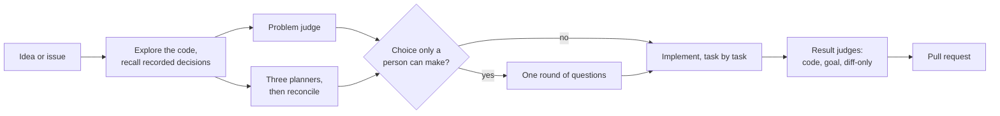

# PRD: Strike Redesign

**Created**: 2026-11-21  |  **Status**: Draft

## Problem Statement
<!-- audience: stakeholder; mode: explanation; length: 2-3 paragraphs; diagram: optional; examples: discouraged -->

`smithy.strike` is Smithy's command for work done directly, without a spec. Its maintainer has stopped using it. A run makes seven sub-agent calls, six of them on the most capable model tier, and what comes out is a twelve-section planning document in a pull request of its own; the code needs a second command, `smithy.forge`, and a second pull request. The one recorded run took 8 minutes 11 seconds and cost $2.45 before any code existed. Strike also never stops to ask, so a misread request surfaces only when someone reads the document. Plan mode followed by a dispatch, or the Superpowers planning skills, get the maintainer to working code sooner and with more say over the direction, so those are what they use.

The cost is that direct work now gets none of what Smithy adds everywhere else: planners that work independently from different angles, which the maintainer counts among the most notable improvements to plan quality the project has made; recall of the repository's recorded decisions and invariants; and the rule that separates a choice only a person can make from a detail the code will settle. The work affected covers a wide range, from changing the colour of a button to a pull request of notable size that still does not justify a spec.

A second consumer is waiting on the same gap. [March's issue-triage RFC](https://github.com/Balexda/March/blob/main/docs/rfcs/2026-003-issue-triage/issue-triage.rfc.md) routes accepted small issues to strike as its small-patch path, replacing the hand-written prompt its issue workers follow today, and expects a patch pull request that links back to the issue. Those workers run with no person present: they may stop and escalate, but must not guess and must not hand back a partial patch. Strike cannot serve them as it stands, because it produces a document where a patch is expected, takes no issue as input, and has no way to stop and ask. We want one command that takes an idea or an issue to a pull request containing the change, asks only when a real choice exists, and brings independent judgment to the problem, the plan and the result at a cost in proportion to the change.

## Proposed Solution
<!-- audience: stakeholder; mode: explanation; length: 1-2 paragraphs; diagram: optional; examples: discouraged -->

`/smithy.strike` takes an idea in words or a GitHub issue and ends with a pull request holding the change and its tests, in one command and one session. On the way it explores the code and recalls the repository's recorded decisions. When the request leaves a choice only a person can make, it asks once, before any code is written; a run with nothing to decide asks nothing. No planning document is committed. The pull request description carries what a reviewer needs from the plan: the decisions taken, the alternatives turned down, a verdict on each acceptance criterion, and the validation result.

The quality comes from independent points of view, not from repetition. At each stage a separate judge sees only the thing it is judging and what to judge it against. One reads the request with no plan in sight. Three planners work from different angles without seeing each other's work. Once the code is written, one reviewer checks it against the task, a second against the original request alone, and a third reads the change with no background at all. How much of this runs follows the change: everything by default, less for a truly trivial change, and a change that has outgrown one pull request is handed to `smithy.mark` with the plan so far. An orchestrator can run strike unattended. It then stops with a `NEED:` line when a critical choice is open, and otherwise finishes and lists every choice it made without a person.

## Target Users
<!-- audience: stakeholder; mode: reference; length: tables only; diagram: optional; examples: discouraged -->

- **The Smithy maintainer**, doing direct work between pipeline runs. Today they reach for plan mode or the Superpowers skills because strike is slower and yields a document, so that work gets no competing plans, no recall and no steering questions.
- **An orchestrator's unattended worker.** March's issue-triage route sends accepted small issues to strike. Today that worker follows a hand-written prompt, and strike cannot replace it: it yields a document, takes no issue, and cannot stop to ask.
- **Teams with Smithy installed**, who run `/smithy.strike` for small features. They gain a pull request with code from one command. The `.strike.md` files they already have must keep working with `smithy.forge`.
- **Template authors**, who would otherwise maintain forge's implement, review and validate procedure in two commands that drift apart.

## Success Signals
<!-- audience: reviewer; mode: reference; length: tables only; diagram: optional; examples: optional -->

- The maintainer uses strike for direct work again: strike-opened pull requests appear in the repositories they work in, in place of plan-mode sessions.
- A one-file fix with nothing to decide completes in one command with 6 sub-agent calls (4 on the deep tier). Strike followed by forge takes 10 (8 deep) across two commands and two pull requests. A four-task change with a real design choice takes 14 calls against today's 13.
- No strike pull request contains a planning document, and an interactive run asks at most one round of questions, none when nothing needs a person.
- An unattended run on an accepted small issue ends in exactly one of two states: a patch that meets every acceptance criterion and links its issue, or a `NEED:` stop that names what is open. It never ends in a guess or a partial patch.

## Alternatives / Build-vs-Buy
<!-- audience: reviewer; mode: explanation; length: 3-6 paragraphs; diagram: optional; examples: recommended -->

### Alternatives Considered

| Name | URL | Category | Fit | Why not |
|------|-----|----------|-----|---------|
| Claude Code plan mode | <https://code.claude.com/docs/en/permission-modes.md> | Built-in agent mode | Partial | What the maintainer uses today. One model plans in one context and a person approves. It has no independent planners, no recall of recorded decisions and no judge of the result against the request. Its edit block holds in non-interactive runs, so it cannot serve an unattended worker, and it exists on one agent only. |
| Superpowers | <https://github.com/obra/superpowers> | OSS skills plugin (MIT) | Partial | Strong steering: questions one at a time, then two or three approaches with a recommendation. It requires design approval on every project "regardless of perceived simplicity", writes a committed spec and a plan document, and leaves pull-request creation as one of four options chosen at the end. That is more stops than strike has today, and every one assumes a person is present. |
| feature-dev | <https://github.com/anthropics/claude-plugins-official> | Agent plugin | Close | Closest in shape: two or three architect agents "with different focuses", then three code reviewers with different focuses. It always waits on a clarifying-questions phase and again for the user to choose what to fix, so it cannot run unattended. It is Claude Code only, and no reviewer is limited to the request alone. |
| BMAD-METHOD (build review step) | <https://github.com/bmad-code-org/BMAD-METHOD> | OSS framework | Partial | Source of two mechanisms adopted here: reviewers restricted by context (one given "the diff only", one given the stated intent and the diff with "no other context about how this change was produced"), and a size rule ("100 lines or fewer: oneshot. Otherwise: full."). It is a complete development method with its own artifacts and workflow, and its review step cannot be taken on its own. |
| Compound Engineering | <https://github.com/EveryInc/compound-engineering-plugin> | OSS agent plugin | Partial | Its `lfg` skill chains plan, work, review and pull request hands-off, and scales review depth (lite, focused, full) to the change. Competing plans are reserved for choices that are costly to reverse, and it keeps its own store of learnings where Smithy has engraved records. |
| Issue-to-PR cloud agents (GitHub Copilot cloud agent, Jules) | <https://docs.github.com/en/copilot/concepts/agents/coding-agent/about-coding-agent> | SaaS | Poor | They take an issue to a pull request unattended, which is the orchestrator half of the need. They run outside the local agent session, so none of Smithy's recall, planners or review routing applies, and March already owns dispatch and worktrees. Jules also waits for a plan approval before any code. |

### Build-vs-Buy Rationale

Nothing external can be dropped in, because what is wanted is Smithy's own machinery applied to small work: recall over engraved records, the gate that decides what becomes a question for a person, the review protocol's routing, and forge's implementation and review sub-agents. All of it exists. Strike today uses the planning half and stops. The build is therefore a rearrangement: one command that reaches from request to pull request by dispatching agents Smithy already ships, plus one new judge that reads the result against the request. The closest outside shape is feature-dev, with competing architects followed by several reviewers. It shows the pattern is in use, but it runs on one agent and waits on a person throughout.

What comes from outside is a set of mechanisms, each already running in a shipped tool:

| Mechanism adopted | Seen in |
|---|---|
| Reviewers made independent by what they are given, not by how many there are | BMAD-METHOD's diff-only and intent-only reviewers |
| Review depth follows the change, and evidence may raise the depth but never lower it | Compound Engineering: "A size floor may only force full, never award lite" |
| Agreement between reviewers on one model does not raise confidence in a finding | Compound Engineering: such agreement "never raises confidence" |
| Questions to the user come from the main session, before or between panels | Claude Code removes the question tool from every sub-agent |
| An unattended run stops with a one-line escalation; it does not guess | March's `NEED:` convention for workers |

### In-House Alternatives Already Rejected

| Alternative | Why not |
|---|---|
| Replace the three-planner panel with one planner | The maintainer's experience is that adding competing plans was among the most notable improvements to plan quality in Smithy. The value is the independent viewpoints, so the panel stays and is skipped only for trivial changes. |
| Have strike write an untracked plan and hand it to forge | The model cannot start forge, because every Smithy command is operator-invoked only, so the work would still take two commands. Forge's completion check also reads a tracked checklist at the branch head, which an untracked plan cannot satisfy. |
| Keep the `.strike.md` document and its pull request | The maintainer does not want the plan checked in, and a document pull request is the wrong result for an issue that expects a patch. |
| Keep no plan file and carry the plan in the session | A long run compacts its context, and a plan held only there can be lost mid-run. |
| Keep the plan file outside the working tree (git directory, home directory, or temp directory) | Each fails on at least one agent without extra permission setup. Codex's sandbox makes the git directory read-only and does not list the home directory as writable. Claude Code protects the git directory and prompts on writes outside the working directory. |
| A panel of two readers on the problem | One judge can list several defensible readings. A second adds a deep-tier call for little. |
| One planner followed by three critics | Every critic anchors on the single plan. The observed gain came from independent proposals. |
| A validator agent, or three disproving voters, for each review finding | The cost is out of proportion to a single pull request. The test suite and the single fix round are the check, and the maintainer agreed to leave it out. |
| Add the new result judges to forge in the same change | They ship in strike first, and forge is decided on the results. |

### Evidence and Its Limits

- **The panel's effect is unmeasured here.** No issue, pull request or document in this repository records a measurement of what the planning lenses add. Keeping them rests on the maintainer's experience.
- **Diverse plans beat repeated ones.** PlanSearch (arXiv 2409.03733) reached 77.0% pass@200 on LiveCodeBench by searching over differing high-level ideas, against 60.6% for sampling the same prompt repeatedly.
- **Withholding context helps where it has been tested.** In AgentCoder (arXiv 2312.13010) a test designer in a separate conversation that had not seen the code wrote accurate tests 87.8% of the time, against 61.0% when it shared the programmer's conversation.
- **Same-model judges overlap and can be wrong together.** In arXiv 2610.01471 two sessions of one model shared 52–62% of their findings, and differences between same-model review set-ups were not statistically significant, apart from a second review in the same session doing worse. In Refute-or-Promote (arXiv 2604.19049) ten reviewers unanimously endorsed a bug that did not exist, and one empirical test removed it. This is why agreement never raises confidence in this design and a failing test outranks any reviewer.
- **Pooling without a check amplifies errors.** In arXiv 2512.08296 independent agents whose output was pooled unchecked amplified errors 17.2 times, against 4.4 times with a central checker, and tasks one agent already did well got worse with more agents. This supports keeping the reconciler, having the parent verify what judges report, and skipping the panel on trivial changes.

## Assumptions
<!-- audience: reviewer; mode: reference; length: tables only; diagram: optional; examples: discouraged -->

- [Critical Assumption] A strike run's result is a pull request containing code and tests. No planning document is committed, in the repository or in an external artifact store. Strike stops producing `.strike.md` files; existing ones stay usable with `smithy.forge`.
- [Critical Assumption] Independence comes from limiting what each judge is given, as the table below sets out. Agreement between judges never raises confidence in a finding. There is no separate validator agent.
- [Critical Assumption] The three-lens plan panel and its reconciler are unchanged and run by default. The panel is skipped only when the change is one task, alters no interface, schema or stored format, conflicts with no recalled record, and raises no question for a person. A change that looks trivial waits for the problem judge, and a steering question from that judge brings the panel back. The size can be raised by the caller or by evidence, never lowered.
- [Critical Assumption] Strike reaches implementation by dispatching forge's implementation, review and documentation-check sub-agents itself. The procedure the two commands share lives in one place that both compose. Forge's behaviour, including its tracked-checklist completion check, does not change.
- [Critical Assumption] Strike keeps a working plan in a git-ignored file in the working tree, proposed as `.smithy/strikes/<branch>.plan.md`, following the precedent of ignite's `.smithy/clarify-logs/`. It holds the request, the acceptance criteria, the decisions taken, and the tasks with their status, and strike re-reads it at each phase so a compacted or resumed run knows where it is. Before the result judges run, the file is cut down to the request, criteria and decisions. It is deleted once the pull request is open.
- [Critical Assumption] Questions come in one round, before any code, and only when a steering choice exists. The only later stop is a criterion still unmet after one fix round.
- [Critical Assumption] Unattended running is an explicit flag and is never inferred. A critical open choice stops the run with `NEED:` before any commit. A lesser one adopts the recommended option and is listed as decided without a person. A criterion still unmet after the fix round stops the run, and no pull request is presented as complete.
- Strike's ceiling becomes "fits one pull request and needs no spec", replacing today's "more than about five tasks" rule that points at `smithy.ignite`. Above the ceiling strike hands off to `smithy.mark` with the working plan as input.
- The goal and diff-only reviewers ship in strike only. Whether forge adopts them is decided after strike has run with them.
- `smithy.fix` stays the command for repairing a pull request after it opens. A strike pull request needs no tracked planning artifact for that to work.
- Gemini CLI, which has no sub-agents, runs the same stages inline and states in its output and in the pull request that no independent review ran.
- Cost is counted in sub-agent calls by tier. No time or token target is set.

| Stage | Judge | Given | Withheld | Runs |
|---|---|---|---|---|
| Problem | `smithy-clarify` | The request verbatim, relevant file paths, recalled records | Any plan | Always |
| Plan | Three `smithy-plan` lenses (Simplification, Separation of Concerns, Robustness), then `smithy-reconcile` | The request, file paths, recalled records | Each other's output | Unless the change is trivial |
| Result | Code reviewer (`smithy-implementation-review`) | The change and the task brief | Nothing relevant | Always |
| Result | Goal reviewer (new) | The request verbatim, the acceptance criteria, the change | The plan, the tasks, other reviewers' findings | Always |
| Result | Diff-only reviewer | The change and the repository | The plan, the tasks, the request | When the plan panel ran |

## Specification Debt
<!-- audience: reviewer; mode: reference; length: index table + 1-3 sentences per item; diagram: optional; examples: discouraged -->

| ID | Title | Source Category | Impact | Confidence | Origin |
|----|-------|-----------------|--------|------------|--------|
| SD-001 | plan-review-on-working-plan | Solution Intent | Medium | Medium | local |
| SD-002 | orchestrated-run-pr-ownership | Scope Edges | High | Medium | local |
| SD-003 | unattended-question-channel | Solution Intent | Medium | Medium | local |

### SD-001 — plan-review-on-working-plan

Unresolved choice between running `smithy-plan-review` on the working plan before implementation starts, as strike does on its document today, and leaving it out of strike. Keeping it costs one deep-tier call on every run that plans. Dropping it leaves plan errors to be caught as defects in the code by the result judges.

**Recommendation:** leave it out — nothing ships from the working plan, and the goal and code reviewers check the outcome in the form it actually takes. Not settled because the drop was proposed before the plan file came back into the design, and how often plan-review has caught something that mattered is the maintainer's experience to weigh.

### SD-002 — orchestrated-run-pr-ownership

For a run started by an orchestrator, unresolved choice between strike opening the pull request itself and strike stopping at commits with a handoff record (title, description, criteria verdicts, choices made without a person) for the orchestrator's own session to open. March's triage RFC speaks of "the patch PR for `strike`", while its worker instructions say to leave pull-request creation to its manager session. The first makes strike responsible for the orchestrator's title and description conventions. The second adds a patch-only mode and a handoff format to strike.

**Recommendation:** build both and let the caller choose — strike opens the pull request unless the caller says it owns that step. Not settled because which March session opens the pull request for a strike run is a design decision in March, and if the answer is always strike, the patch-only mode should not be built.

### SD-003 — unattended-question-channel

When an unattended run meets a critical open choice, unresolved choice between stopping with a `NEED:` line only and also posting the question as a comment on the originating issue. The hand-written issue prompt that strike is to replace asks on the issue and waits. The orchestrator already forwards `NEED:` lines and parks the run.

**Recommendation:** `NEED:` only — one channel, and strike writes nothing to GitHub except the pull request. Not settled because the current path reaches the maintainer on the issue itself, and whether that should survive the replacement is theirs to say.

## Open Questions
<!-- audience: reviewer; mode: reference; length: tables only; diagram: optional; examples: discouraged -->

- Whether a git-ignored plan file inside the working tree stays out of the context-limited judges' reach in practice. Claude Code's file-name search does not honour ignore rules by default, which is why the design cuts the file down before those judges run. A probe on Claude and on Codex should show whether that is enough, or whether the file must be deleted outright at that point or moved outside the tree, which needs the kind of per-agent permission probe PRD 2026-002 already lists as open.
- Whether a Codex sub-agent starts with only what its dispatch gives it, as a Claude sub-agent does. Every "withheld" cell in the judges table depends on it, so it needs a probe before the RFC fixes per-agent behaviour.
- Whether the judges are independent enough to earn their cost. This needs eval runs that measure how far the goal reviewer's findings overlap the code reviewer's, with a planted defect and with a design choice hidden inside a one-file change, the likeliest miss for the trivial-change rule.
- How this lands relative to March's issue-triage work. That RFC's strike milestone states "No Smithy stage changes", and its verdict rubric describes the route as producing "a strike plan"; both need amending. March's expectations of branch name and pull-request title for a strike run also need reconciling with what strike produces. Which side moves first is the maintainer's call.
