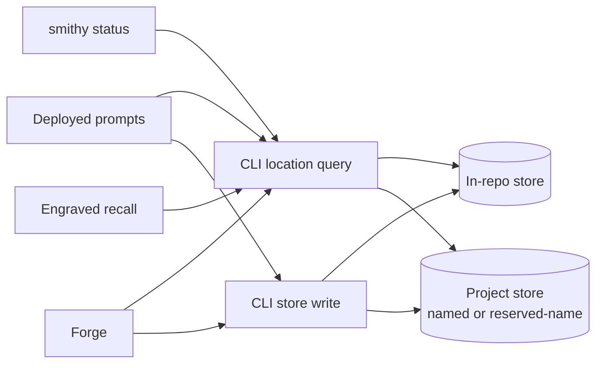

# RFC: Planning Artifact Location Model

**Created**: 2026-11-14  |  **Status**: Draft

## Summary

This RFC makes Smithy's CLI the single owner of where planning artifacts and engraved records live whenever they live outside the repository. On such an install, deployed prompts refer to artifacts by logical place, one CLI call per run returns every concrete location along with the rule that chose it, and every write to a store, commit included, goes through the CLI. Parallel workstreams and multi-repo projects each get a home of their own and forge records its progress in the right store from any worktree, while an install that keeps everything in the repository never calls the CLI at all and sees no change.

## Motivation / Problem Statement

On 1 November 2026 the maintainer could not cut spec 007, a project that spans four repositories, because the one out-of-repo store the install provides was taken up by spec 001. It was checked out on 001's branch, it held five uncommitted 001 files, and four 001 forge sessions were still running against it. Neither spec had done anything wrong. Two workstreams simply cannot share one checkout. The same design fails in two more ways. A project spanning several repositories has no home of its own, because the store belongs to a single repository. And forge, running in a code worktree, follows a fixed path back to the shared store, but the progress it records there is committed in the code worktree instead. That is how uncommitted planning files pile up behind a running workstream. This is one incident, and nobody has measured how often such collisions happen. The case for fixing it rests on the structure: while location has no single owner, this class of failure stays reachable.

All three failures come from one cause. The location of planning documents is written into prompt text once, at install time, in 97 places across 17 templates. Every later answer to "where do artifacts live" has been added as another layer on that fixed location: in-repo versus external, per-repository versus shared, named projects, worktrees, and cross-repository slices. Each layer has meant agent-side path rewriting, a status lookup that tries several stores in turn, commit instructions inside prompts that are specific to one store, or permission lists that name store paths. A stopgap, PR #610, let commands choose a store at run time. That would have unblocked the incident, but it put a second resolution mechanism on top of the first, and it was closed unmerged. Reviews of that work found the rule for "which project is in play" implemented in three places. They also found that the location instructions every planning command loads had grown from 13 lines to 115, a context cost paid even by teams who keep planning in their repository and never touch an external store. Now is the time to act because each further layer makes the next one harder to remove. This model is built from `master` and replaces that stopgap instead of building on it.

The goal is one model for where planning artifacts and engraved records live, how every command finds them, and how they are committed. Under that model, prompts carry no filesystem location. The decision about which project is in play is made in exactly one place, and the working directory's name is never treated as a signal for it. Store kinds collapse to two: in the repository, or a project store. Today's repo-keyed store is addressed as the project named after its repository, the shared default store under a reserved name that no user project can claim, and readdressing them never changes the level of the records they hold. There are two ways to run Smithy, and the model treats them differently. An install that keeps skills and artifacts in the repository sees no change and never calls the CLI for a location or a commit, so it keeps working where no `smithy` binary exists, such as a sandbox. An install that keeps artifacts outside the repository has a store the CLI set up on that machine, so its prompts can rely on the CLI being there. When this is done, two workstreams on one machine never share a checkout or a branch, a multi-repo project has one home tied to none of its repositories, and forge leaves its progress in the store it belongs to, whatever worktree it runs in.

## Goals

- **Parallel workstreams never share a store.** Two specs in different projects can be cut and forged at the same time on one machine. They never share a store checkout or a branch, so the 2026-11-01 collision cannot happen again.
- **A multi-repo project has one home of its own.** A project that spans several repositories gets a single project store that belongs to none of those repositories. Each of its repositories reaches that same store.
- **Forge records progress in the right store from any worktree.** A forge session running in a code worktree commits its progress to the store the tasks file belongs to, not to the code checkout. Uncommitted planning files no longer pile up behind a running workstream.
- **Deployed prompts carry no filesystem root.** None of today's 97 `{{artifactsRoot}}` sites across 17 templates remain. The only location fact an install renders into a prompt is which of the two modes it is. Out-of-repo prompts name artifacts by logical place ("this workstream's specs", "this repo's decisions") and in-repo prompts name the repository's own relative paths, so there is no baked-in prefix left to get wrong.
- **Location is resolved in one place, once per run.** On an out-of-repo install, a single CLI call per run returns every concrete location the command needs, each paired with the rule that produced it. That one answer serves the planning commands, status discovery, engraved recall and forge. The working directory's name is never a signal for which project is in play.
- **Writes to an out-of-repo store go through the CLI.** Prompts carry no store `git` commands. The CLI's commit tolerates a store with no git history: it skips the commit with a notice and never runs `git init` or pushes.
- **Location text stays at its repo-mode size.** The location instructions each planning command loads fit in roughly the 13 lines repo mode carries today, not the 115 lines the closed stopgap grew them to.
- **Store kinds collapse to two.** A store is either in the repository or a project store. Today's repo-keyed store is addressed as the project named after its repository, and the shared `default` store under a reserved name that no user project can take. Readdressing a store this way never changes the level of the records it holds.
- **Repo-mode installs behave exactly as they do today.** Teams that keep planning in their repository see no observable change. Their prompts never call the CLI for a location or a commit, so they work on a machine with no `smithy` binary on PATH, including inside a sandbox.

## Out of Scope

- **Changes to the engraved record schema, its edges, or its levels.** Only where records live changes. Their frontmatter, citation edges and the user/repo/project level model stay as they are.
- **Remote sync or push of stores.** The CLI commits locally and never pushes or syncs with a remote. Sharing a store across machines would need its own design and a separate effort.
- **Guessing a store from the working directory or a walk-up marker search.** Using the working directory as a signal is ruled out. A walk-up marker was already rejected because forge runs in the code worktree, so the artifact or the invocation has to declare the project.
- **Rebuilding PR #610's prefix-substitution mechanism.** PR #610 was closed unmerged and this work starts from `master`. The logical-place model replaces run-time prefix substitution, and `smithy root`'s prefix output is not built. Named project stores, `smithy status --project` and the `**Project**` header are built as part of this model.
- **Intra-project concurrency tools beyond the commit.** Atomic single-cell edits of a Dependency Order row and story-scoped debt ids are not delivered. Orchestrators keep the rest of the parallel-cut preamble (edit only your own row, reserved debt-id ranges), and the Specification Debt content model is unchanged.
- **Physically importing existing stores.** Today's repo-keyed and `default` stores are readdressed where they sit. No command moves them into named project stores or rewrites their Artifact cells.
- **A per-machine project registry.** A project exists because its directory exists. No registry file lists projects, member repositories or aliases.

## Personas

- **The Smithy maintainer** — Runs several multi-repo workstreams from one machine and drives mark → cut → forge agent sessions in parallel. Today a second workstream collides with the first one's store checkout and branch, which is how spec 007 got stuck behind spec 001's branch, its five uncommitted files and its four running forge sessions. Under this RFC each workstream gets its own store, and a project spanning several repositories has one home tied to none of them, so the maintainer can cut and forge two specs side by side without either one blocking the other.
- **Teams with repo-level installs** — Keep their planning inside the repository and never touch an external store. They notice nothing today and must notice nothing afterwards, so they are a hard compatibility constraint, not a group gaining features. What they get is negative space: the location text each command loads stays near its 13-line repo-mode size instead of growing to the 115 lines the closed stopgap needed for stores they don't use.
- **Template authors** — Maintain one template source for three agent runtimes and pay context budget for every line of location text. Today 97 sites across 17 templates name a root, and the closed stopgap grew location policy to 115 lines in every composing command. With the CLI as the only owner of location, templates refer to artifacts by logical place, carry no store `git` commands, and have no filesystem root left that a prefix-mismatch bug could get wrong.
- **The orchestrator that hands forge a tasks path** — A non-human stakeholder: an agent-session orchestrator that pre-stages worktrees and launches forge with a tasks file path, in environments where IDE and agent-deck launches do not reliably carry a per-session environment. It benefits when forge can find the right store, and commit its progress there instead of in the code worktree, from that input alone with no per-session setup. Whether the tasks path alone is enough, or the tasks file must also carry a store identity, is settled by experiment during this work.
- **The teammate using committed prompts with no `smithy` binary installed** — A member of a repo-mode team who uses the prompts committed to the repository without installing Smithy. Their experience stays the same. In-repo prompts never call the CLI for a location or a commit, so nothing they do today starts requiring an install, and the same holds for an agent working in a sandbox.

## Proposal

Smithy's CLI becomes the only component that knows where planning artifacts and engraved records live. It offers two contracts, and everything else uses them. The **location query** takes the install and the declared project and returns every logical place a run may touch, each mapped to a concrete location and paired with the rule that chose it. The **store write** takes an explicit store and returns a commit. Deployed prompts, status discovery, engraved recall and forge all use these two contracts, and none of them defines location for itself. As a result, the rule for "which project is in play" exists once, inside the CLI, not in prompt text, status code and forge instructions separately.

A run asks the location query once, at the start, and gets every location it needs in a single answer. The project comes from what the invocation or the input artifact declares: the `--project` surface or the artifact's `**Project**` header. The working directory is never used. Each location comes back in portable tilde form along with the rule that produced it, so an agent never has to work out precedence. The table below is an illustrative example of one answer for a run in project `fleet-sync`. The names and rows are examples only, not a schema.

| Logical place (illustrative) | Concrete location | Rule that chose it |
|---|---|---|
| This workstream's specs | `~/.smithy/projects/fleet-sync/specs/` | Project declared by the input artifact's `**Project**` header |
| This project's decisions | `~/.smithy/projects/fleet-sync/decisions/` | Project-level records sit at the project store's root |
| This repo's decisions | `~/.smithy/repos/<key>/docs/decisions/` | Repo-keyed store addressed as the project named after its repository; records stay repo-level |
| User-level invariants | `~/.smithy/invariants/` | Fixed user store, never managed by an install |

The store write follows "explicit store in, commit out". It works from any working directory, so a forge session in a code worktree commits its progress to the store the tasks file belongs to, not to the code checkout. Commits from parallel workstreams to their own stores do not collide. Prompts no longer carry store `git` commands. If a store has no git history, the write leaves the files in place, skips the commit and prints a notice. It never runs `git init` and never pushes. A CLI commit on its own retires only the index-lock and no-push rules of today's parallel-cut preamble. The other intra-project concurrency tools are out of scope, so orchestrators keep the rest of that preamble.

Store kinds collapse to two: in the repository, or a project store. Today's repo-keyed store and the shared `default` store become project stores where they sit: the repo-keyed store is the project named after its repository, and the `default` store is addressed under a reserved name that no user project slug can take. No files move. A named project exists because its directory exists under the projects store; there is no registry. A store's role decides the level of its records, and the name used to address it does not, so readdressing a store never changes the level of what it holds. `smithy init` no longer writes a location into prompts. What it still records is the install's mode, and the two modes get different prompt text. An in-repo install's prompts name the repository's own paths, as they do today, and contain no CLI call for locations or commits. An out-of-repo install's prompts use the location query and the store write, and can assume the CLI is present because the CLI set up the store on that machine. Named project stores are reached from out-of-repo installs. `smithy update` re-renders prompts and never touches stores.

The query reports its edge cases as outcomes, not guesses:

- **Invalid project slug:** refused, with a message naming the problem.
- **More than one candidate project:** the answer names the candidates and never picks one by name.
- **No project declared:** on an out-of-repo install the project inherits the repository's name, so reads and writes resolve to the install's own store. The query never asks and never guesses. An in-repo install does not reach the query; it writes to the repository as it does today.
- **Store path missing:** reported as absent. The query does not create it.
- **Store is not a git repository:** the query answers normally, and the write skips its commit with a notice.
- **Code worktree:** it resolves to the same project store as its main checkout, so mark in one and forge in the other see one store.

## Design Considerations

**The working directory is never a signal, and forked commands cannot ask.** The project in play comes only from what the invocation or the input artifact declares. It never comes from the working directory's name or from searching upward for a marker file. Forge runs in a code worktree whose path says nothing about the planning store, so any rule based on the working directory would send it to the wrong store. This interacts with D-4: mark, cut and render may run forked, and a forked command cannot stop to ask the user. So the query has to be answerable from the invocation and the input artifact alone. When those leave the project undeclared, an in-repo install writes to its repository, which is the home it chose at install. An out-of-repo install inherits the repository's name as its project: its store has only ever been keyed by that name, so the answer is deterministic and existing installs carry forward unchanged. The inherited name comes from the key that already locates the install's store, which is the same from every worktree of the repository, and not from the directory a command happens to run in. Asking is ruled out by the one-shot contract.

**Level follows the store's role, not its address.** Today, repo-level engraved records sit under a store's `docs/decisions/`, `docs/invariants/` and `docs/constitution/`, while project-level records sit directly under `~/.smithy/projects/<slug>/`. Addressing a repo-keyed or `default` store as a reserved-name project must not turn its repo-level records into project-level ones. If it did, record ids, precedence, and the legality of `excepts` and supersession edges would all shift without anyone editing a record. Existing stores are reinterpreted in place, so the reserved-name mapping keeps the `docs/` segment and the repo level as a permanent rule of the query. No files move and no Artifact cell is rewritten. That leaves `smithy update` nothing to migrate, which matters because it never moves user-authored artifacts or manages the home-level store.

**The directory layout owns the project entity.** A project exists because its directory exists under the projects store, which is how projects are listed today. This adds no per-machine state beside the user store that Smithy deliberately never manages. Reserved names are a fixed rule of the CLI, and a repository learns its project from what the invocation or the artifact declares, so membership needs no stored map. The cost is that per-project metadata has nowhere to live. An explicit registry was considered and set aside because no stated requirement needs that metadata. The query is the only reader of the layout. No prompt or status path consults it directly.

**Two modes, and the CLI in only one of them.** An in-repo install has its skills and its artifacts in the repository, and its prompts involve the CLI for neither locations nor commits. Any dependency there would break simple cases, such as an agent working in a sandbox with no `smithy` binary, and would break the promise that repo-mode teams see no change. An out-of-repo install needs a separate artifact store on disk, and the CLI is what configures that store on that machine. So a machine that has the store has the CLI, and out-of-repo prompts can call it without a fallback. If the binary is missing anyway, the run stops with an install message and writes nothing into the code repository. This also settles INV-2, which requires every actionable reference in a deployed template to resolve where it is deployed: in-repo prompts carry no CLI reference, and out-of-repo prompts are only ever deployed by the CLI they call. The cost is that the install mode stays as a render-time switch, so the shared location fragment has two short forms to keep within budget instead of one.

**Context budget and one canonical home.** P-1 treats always-loaded context as a budget. The target is for each command's location text to shrink back to roughly the 13 lines repo mode carries today. That only works if prompts describe how to call the query and the write and how to read the answer, and never restate the precedence the CLI applies. Under INV-1, those instructions live in one shared fragment that every consuming template composes. The rule for which project is in play lives only in the CLI. The answer reports the rule that chose each location, so a prompt never needs its own copy of the rule to explain a result. The three-places finding from the stopgap's review is the failure this rules out.

**Experiments, and the relationship to PR #610.** Two questions are settled by experiment during the work and are not steering debt:

- **Per-runtime permissions.** Under D-3 and INV-3, the deployers emit whatever permission metadata each runtime actually reads. A probe has to show whether Gemini CLI and Codex can grant the location call and the CLI-mediated commit without their permission files listing store paths, as they do today.
- **Forge store identity.** The question is whether a tasks path handed over by an orchestrator, together with the existing `**Project**` header, is enough for forge to find and commit to the right store, or whether the tasks file needs an explicit store identity.

PR #610 was closed unmerged, so this work starts from `master`. Named project stores, `smithy status --project` and the `**Project**` header are built as part of the location contract, and the forge experiment runs against that implementation, not the closed branch. The prefix-substitution mechanism and `smithy root`'s prefix output are not built. Resolving the store from an input artifact, which #610 exposed as `--from`, is a capability of the location query; the shape of that surface is left to the spec.

## Decisions

- **Build the location model in the CLI; adopt no external tool.** The PRD's survey found one close analogue, OpenSpec Stores, which is a rival workflow that cannot be embedded, never commits, and allows one checkout per store. Its precedence-with-provenance answer and its refusal to guess a store by name are borrowed as design references.
- **Two contracts, not one.** Location query and store write are separate because they carry different unknowns: the write has permission and concurrency concerns the query does not. Because the write takes an explicit store, it does not need the query to exist first.
- **All six steering choices are resolved in this RFC.** The five carried from the PRD and the one found here were decided on 2026-11-15 and are recorded under Specification Debt. None is passed down to the feature maps as open debt.
- **Build from `master`.** PR #610 was closed unmerged. Its `smithy status --project` surface and the `**Project**` header are built fresh inside the location contract; its prefix substitution and `smithy root`'s prefix output are not.
- **The commit is the only concurrency tool.** Atomic cell edits and story-scoped debt ids stay out, which leaves the Specification Debt grammar that resolve, audit and the status parser rely on untouched.
- **An undeclared project inherits the repository's name.** Out-of-repo installs have only ever been keyed by repository name, so an empty project name resolves deterministically to the install's own store and existing installs carry forward with nothing to migrate. A multi-repo project is the case that declares a project. An in-repo install writes to its repository as before. This replaces the earlier decision to refuse undeclared writes when named project stores exist.
- **Existing stores are reinterpreted in place.** No files move, which keeps every record's level and every citation intact.
- **The directory layout owns the project entity.** It needs no new per-machine state, and no stated requirement needs per-project metadata.
- **The two PRD open questions are experiments, not debt.** The per-runtime permission probe and the forge store-identity question are settled by running them, so they are written as criteria on the work they gate. If the permission probe fails for a runtime, the choice that follows is recorded as new debt at that point.
- **Level follows the store's role.** Readdressing a repo-keyed store as its repository's project, or the `default` store under its reserved name, never changes its records' level, which follows from leaving the engraved level model untouched. Reserved names are rejected as user project slugs.
- **The working-directory rule is stated here in prose.** The PRD cites it as "D-5 / INV-4", but no engraved record with either id exists; the rule lives only in the project-resolution text the planning commands compose. This RFC states the rule directly and cites neither id. Engraving it is a follow-up for `smithy.engrave`.
- **In-repo installs never call the CLI; out-of-repo installs assume it.** This replaces both options the PRD offered for the no-binary case. An in-repo install has no CLI dependency for locations or commits, so it works in a sandbox. An out-of-repo store only exists where the CLI created it, so its prompts need no fallback.
- **Existing-store continuity is its own body of work.** It affects only external-store users, and separating it keeps the location contract small and lets continuity proceed alongside the templates.
- **The 2026-11-01 scenario is the acceptance test.** It needs the query, the write, location-free templates and store continuity together, so it is verified once, end to end, after the rest.

## Specification Debt

All six items are resolved. SD-001 to SD-005 were carried down from the parent PRD, `docs/prds/2026-002-planning-artifact-location.prd.md`, which still lists them as open.

| ID | Title | Source Category | Impact | Confidence | Origin |
|----|-------|-----------------|--------|------------|--------|

### Resolved

#### SD-001 — phase-1-pr-610-supersede-or-build-on

**Question:** Unresolved choice between landing PR #610 as-is and migrating off its prefix-substitution mechanism afterwards, closing it and building the model from `master`, or reworking the branch in place before merging. The choice decides whether `smithy root`'s prefix output, the `**Project**` header, and `--from` remain as compatibility surfaces users can observe.

**Answer:** Resolved 2026-11-15 — build from `master`. PR #610 was closed unmerged on 2026-11-11 and stays closed. `smithy status --project` and the `**Project**` header are built fresh as part of the location contract; `smithy root`'s prefix output and prefix substitution are not built.

#### SD-002 — intra-project-concurrency-in-scope

**Question:** Unresolved choice between including the proposal's other phase-3 tools (atomic single-cell edits of a Dependency Order row, story-scoped debt ids) and limiting scope to the CLI commit operation while orchestrators keep the rest of the parallel-cut preamble. Scoped debt ids would change the Specification Debt content model, which this PRD otherwise leaves untouched.

**Answer:** Resolved 2026-11-15 — the CLI commit only. The other tools are out of scope for this RFC, orchestrators keep the rest of the parallel-cut preamble, and the Specification Debt content model is unchanged.

#### SD-003 — undeclared-project-write-fallback

**Question:** What should a planning write do when named project stores exist but no project is declared, by `--project` or by the input artifact? Unresolved choice between falling through to the install root with a warning (the phase-1 behaviour, which risks one project's specs scattering across two stores) and refusing the write with a message naming `--project`. Asking is ruled out by the one-shot contract.

**Answer:** Resolved 2026-11-15, revised the same day while mapping Milestone 1 — inherit the repository's name. On an out-of-repo install an empty project name resolves to the project named after the repository, which is the install's own store, so nothing is refused and nothing scatters. An in-repo install keeps writing to its repository, so repo-mode teams see no change. The first answer, refusing the write when named project stores exist, is withdrawn.

#### SD-004 — existing-store-migration-shape

**Question:** Unresolved choice between reinterpreting today's repo-keyed and `default` stores in place (same paths, addressed as projects under reserved names, no files move) and physically importing them into named project stores through an explicit `project import` that rewrites Artifact cells and leaves a tombstone. `smithy update` cannot move them on its own, because it never moves user-authored artifacts or manages the home-level store.

**Answer:** Resolved 2026-11-15 — reinterpret in place. Same paths; the repo-keyed store is addressed as the project named after its repository and the `default` store under a reserved name; no files move and record levels and citations are untouched. A physical import is out of scope.

#### SD-005 — behaviour-without-smithy-binary

**Question:** Should location-free templates work when no current `smithy` binary is on PATH, as for teammates of a repo-mode install who use committed prompts without installing Smithy? Unresolved choice between prompts carrying the in-repo layout as the logical-name default with the CLI call only redirecting when available, and every mode requiring the CLI and failing with an install message when it is absent. The first keeps the "repo-mode teams see no change" promise; the second is purer but breaks it.

**Answer:** Resolved 2026-11-15 — split by install mode, which is neither option as posed. In-repo prompts name the repository's own layout and never call the CLI for a location or a commit, so they work with no `smithy` binary, including in a sandbox. Out-of-repo prompts require the CLI and need no fallback, because an out-of-repo store exists only on a machine where the CLI configured it; if the binary is missing they stop with an install message.

#### SD-006 — project-entity-ownership

**Question:** Who owns the project entity that the resolver reads? Unresolved choice between (a) the directory layout, where a project exists iff `~/.smithy/projects/<slug>/` exists, as `listProjectSlugs()` treats it today, and (b) an explicit per-machine registry file (OpenSpec-style) that lists projects and their metadata, such as member repos and reserved-name aliases for legacy stores. Option (a) adds no new state but cannot hold per-project metadata. Option (b) adds a file the CLI must create and keep consistent, and it must stay outside any manifest because the user store is unmanaged. A manifest-owned option is effectively ruled out for that same reason.

**Answer:** Resolved 2026-11-15 — the directory layout. A project exists if its directory exists under `~/.smithy/projects/`; reserved names are a fixed rule of the CLI and there is no registry file.

## Milestones

### Milestone 1: Workspace Location Contract and Read Path

**Description**: Introduces the CLI location query, which answers once per run every location a command may touch, each paired with the rule that chose it, and decides in one place which project is in play. Status discovery, engraved status and engraved recall move onto that answer so none of them resolves location for itself. A declared project gets its own store keyed to no repository. It is built from `master`, takes `--project` and the `**Project**` header as its declared inputs, and treats a project as existing when its directory exists.

**Success Criteria**:
- One CLI call per run returns every logical place the run needs, each with a concrete location in portable tilde form and the rule that produced it.
- Status, engraved status and engraved recall return the same locations as the query for the same invocation, and none of them falls back to its own lookup order.
- Only declared inputs decide which project is in play: the invocation's `--project` or the input artifact's `**Project**` header. With neither declared, an out-of-repo install's project is the one named after its repository, taken from the key that already locates that install's store. The directory a command runs from never changes the answer.
- A declared project resolves to a store that belongs to no single repository, and each repository in that project resolves to the same store.
- Each edge case comes back as an outcome, not a guess. An invalid slug is refused with a message naming the problem. Several candidate projects are listed by name and none is picked. A missing store is reported absent and not created. A store that is not a git repository gets a normal answer. A code worktree resolves to the same store as its main checkout.
- Reserved store names are rejected when used as user project slugs.
- With no declared project, an out-of-repo install's reads and writes resolve to the install's own store, addressed as the project named after its repository. The query never asks.
- An in-repo install never needs the query: nothing it does for locations calls the CLI.
- Repo-mode installs see identical status, engraved status and recall output before and after.

### Milestone 2: CLI-Mediated Store Commit

**Description**: Introduces the store write contract: it takes an explicit store and returns a commit, so it does not wait for the location query and can start alongside Milestone 1. Before work starts, the permission probe has to show whether Gemini CLI and Codex can grant the CLI commit and the location call without their permission files listing store paths. A runtime that fails the probe is recorded as new debt. The scope is the commit alone; the other intra-project concurrency tools are out of scope.

**Success Criteria**:
- The permission probe has been run against Gemini CLI and Codex, and its result is recorded for each runtime before work on the write starts.
- A commit made from any working directory, including a code worktree, lands in the store it names and nowhere else.
- Commits made in parallel to different stores all succeed without index-lock collisions or interleaved changes.
- When a store has no git history, its files stay in place, no commit is made and a notice is printed. The write never initialises a repository and never pushes.
- Permission files no longer list store paths on any runtime where the probe shows the grant works without them.
- Repo-mode commits behave exactly as before.

### Milestone 3: Location-Free Templates

**Description**: Moves every out-of-repo prompt onto the location query and the store write, so those prompts name artifacts by logical place and carry no filesystem root and no store `git` commands. In-repo prompts keep naming the repository's own paths and call the CLI for neither. The location instructions shrink into one shared fragment of roughly the 13 lines repo mode carries today. The install mode is the only location fact rendered into a prompt. This milestone depends on Milestones 1 and 2.

**Success Criteria**:
- None of the 97 `{{artifactsRoot}}` sites across the 17 templates remain.
- No deployed prompt contains a `git` command aimed at a store.
- The location text each planning command loads comes to roughly 13 lines, lives in one shared fragment, and an automated check fails the build if a template restates it or grows past that budget.
- Forked mark, cut and render runs get their locations without asking the user anything.
- A given invocation resolves and commits to the same locations on Claude, on Gemini's inline path and on Codex.
- Installing writes no location into prompts. The only install-time location fact is the mode, in-repo or out-of-repo.
- `smithy update` re-renders prompts and leaves every store's contents and git state untouched.
- In-repo prompts contain no CLI call for locations or commits, and an in-repo install behaves exactly as before on a machine with no `smithy` binary on PATH, including in a sandbox. INV-2 holds without an exception.
- An out-of-repo prompt on a machine with no `smithy` binary stops with an install message and writes nothing into the code repository.

### Milestone 4: Existing-Store Continuity

**Description**: Keeps today's repo-keyed and shared `default` stores reachable as project stores, the first as the project named after its repository and the second under a reserved name, reinterpreted in place: same paths, no files moved. Records keep their level and existing artifact links keep resolving. This milestone depends on Milestone 1.

**Success Criteria**:
- Every existing repo-keyed store can be reached as the project named after its repository, and the `default` store through its reserved name, each at its existing path, with no file moved or rewritten.
- No engraved record changes level: ids, precedence, and the legality of `excepts` and supersession edges are the same before and after.
- No artifact is lost, and every Artifact cell in an existing `## Dependency Order` table still resolves to a file or folder that exists.
- Readdressing stores never modifies the user-level store, and `smithy update` never moves user-authored artifacts.

### Milestone 5: Parallel Workstreams and Forge From Any Worktree

**Description**: Checks the whole model end to end against the 2026-11-01 scenario as its acceptance test, once the location-free templates and store continuity are both in place. This milestone carries the forge store-identity experiment, which tests whether a tasks path plus the existing `**Project**` header is enough for forge to find and commit to the right store. It depends on Milestones 3 and 4.

**Success Criteria**:
- On one machine, two specs in different projects are cut and forged in parallel, and they never share a store checkout or a branch.
- A forge run in a code worktree records its progress as a commit in the store its tasks file belongs to, and the code worktree ends with no planning-file changes.
- A project that spans several repositories uses one store from each of them, and an artifact written from one repository can be seen from the others.
- The forge store-identity experiment has been run with an orchestrator-supplied tasks path and no per-session environment, and its result is recorded. If the path plus header is not enough, the store identity the tasks file needs is recorded as follow-up work.
- Throughout the scenario, a repo-mode install on the same machine behaves exactly as before.

## Dependency Order

Recommended implementation sequence:

| ID | Title | Depends On | Artifact |
|----|-------|------------|----------|
| M1 | Workspace Location Contract and Read Path | — | — |
| M2 | CLI-Mediated Store Commit | — | — |
| M3 | Location-Free Templates | M1, M2 | — |
| M4 | Existing-Store Continuity | M1 | — |
| M5 | Parallel Workstreams and Forge From Any Worktree | M3, M4 | — |
