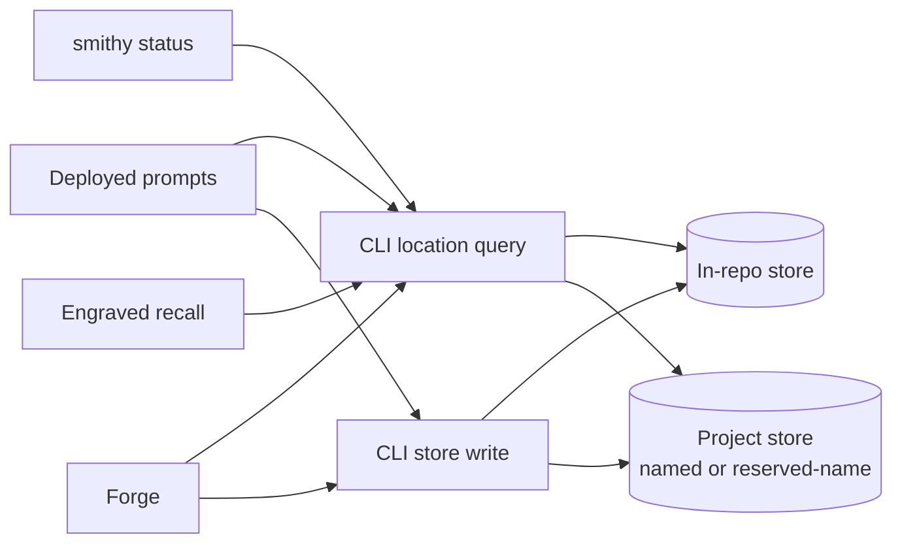

# RFC: Planning Artifact Location Model

**Created**: 2026-11-14  |  **Status**: Draft

## Summary

This RFC makes Smithy's CLI the single owner of where planning artifacts and engraved records live. Deployed prompts refer to artifacts by logical place, one CLI call per run returns every concrete location along with the rule that chose it, and every write to a store, commit included, goes through the CLI. Parallel workstreams and multi-repo projects each get a home of their own, forge records its progress in the right store from any worktree, and repo-mode installs see no change.

## Motivation / Problem Statement

On 1 November 2026 the maintainer could not cut spec 007, a project that spans four repositories, because the one out-of-repo store the install provides was taken up by spec 001. It was checked out on 001's branch, it held five uncommitted 001 files, and four 001 forge sessions were still running against it. Neither spec had done anything wrong. Two workstreams simply cannot share one checkout. The same design fails in two more ways. A project spanning several repositories has no home of its own, because the store belongs to a single repository. And forge, running in a code worktree, follows a fixed path back to the shared store, but the progress it records there is committed in the code worktree instead. That is how uncommitted planning files pile up behind a running workstream. This is one incident, and nobody has measured how often such collisions happen. The case for fixing it rests on the structure: while location has no single owner, this class of failure stays reachable.

All three failures come from one cause. The location of planning documents is written into prompt text once, at install time, in 97 places across 17 templates. Every later answer to "where do artifacts live" has been added as another layer on that fixed location: in-repo versus external, per-repository versus shared, named projects, worktrees, and cross-repository slices. Each layer has meant agent-side path rewriting, a status lookup that tries several stores in turn, commit instructions inside prompts that are specific to one store, or permission lists that name store paths. The stopgap now under review, PR #610, lets commands choose a store at run time. That unblocks the incident, but it puts a second resolution mechanism on top of the first. Reviews of that work found the rule for "which project is in play" implemented in three places. They also found that the location instructions every planning command loads had grown from 13 lines to 115, a context cost paid even by teams who keep planning in their repository and never touch an external store. Now is the time to act because each further layer makes the next one harder to remove. Whether this model supersedes PR #610 or builds on it is one of the open choices this RFC carries.

The goal is one model for where planning artifacts and engraved records live, how every command finds them, and how they are committed. Under that model, prompts carry no filesystem location. The decision about which project is in play is made in exactly one place, and the working directory's name is never treated as a signal for it. Store kinds collapse to two: in the repository, or a project store. Today's repo-keyed and shared default stores are addressed as projects under reserved names that no user project can claim, and readdressing them never changes the level of the records they hold. Repo-mode installs see no change. How location-free prompts behave on a machine with no `smithy` binary is still an open choice, and the promise does not yet extend to that case. When this is done, two workstreams on one machine never share a checkout or a branch, a multi-repo project has one home tied to none of its repositories, and forge leaves its progress in the store it belongs to, whatever worktree it runs in.

## Goals

- **Parallel workstreams never share a store.** Two specs in different projects can be cut and forged at the same time on one machine. They never share a store checkout or a branch, so the 2026-11-01 collision cannot happen again.
- **A multi-repo project has one home of its own.** A project that spans several repositories gets a single project store that belongs to none of those repositories. Each of its repositories reaches that same store.
- **Forge records progress in the right store from any worktree.** A forge session running in a code worktree commits its progress to the store the tasks file belongs to, not to the code checkout. Uncommitted planning files no longer pile up behind a running workstream.
- **Deployed prompts carry no filesystem root.** None of today's 97 `{{artifactsRoot}}` sites across 17 templates remain. Prompts name artifacts by logical place ("this workstream's specs", "this repo's decisions"), so there is no baked-in prefix left to get wrong.
- **Location is resolved in one place, once per run.** A single CLI call per run returns every concrete location the command needs, each paired with the rule that produced it. That one answer serves the planning commands, status discovery, engraved recall and forge. The working directory's name is never a signal for which project is in play.
- **Writes to a store go through the CLI.** Prompts carry no store `git` commands. The CLI's commit tolerates a store with no git history: it skips the commit with a notice and never runs `git init` or pushes.
- **Location text goes back to its original size.** The location instructions each planning command loads shrink from the stopgap's 115 lines back to roughly the 13 lines repo mode carries today.
- **Store kinds collapse to two.** A store is either in the repository or a project store. Today's repo-keyed and shared `default` stores are addressed as projects under reserved names that no user project can take. Readdressing a store this way never changes the level of the records it holds.
- **Repo-mode installs behave exactly as they do today.** Teams that keep planning in their repository see no observable change. What happens on a machine with no current `smithy` binary on PATH depends on how the open choice on that question (SD-005) is resolved. This RFC does not promise unchanged behaviour in that case until the choice is made.

## Out of Scope

- **Changes to the engraved record schema, its edges, or its levels.** Only where records live changes. Their frontmatter, citation edges and the user/repo/project level model stay as they are.
- **Remote sync or push of stores.** The CLI commits locally and never pushes or syncs with a remote. Sharing a store across machines would need its own design and a separate effort.
- **Guessing a store from the working directory or a walk-up marker search.** Using the working directory as a signal is ruled out. A walk-up marker was already rejected because forge runs in the code worktree, so the artifact or the invocation has to declare the project.
- **Rebuilding PR #610's prefix-substitution mechanism.** The logical-place model replaces run-time prefix substitution; it is not reimplemented. Whether #610's user-facing pieces survive as compatibility surfaces is settled by the open choice on that PR (SD-001), not by this exclusion.

## Personas

- **The Smithy maintainer** — Runs several multi-repo workstreams from one machine and drives mark → cut → forge agent sessions in parallel. Today a second workstream collides with the first one's store checkout and branch, which is how spec 007 got stuck behind spec 001's branch, its five uncommitted files and its four running forge sessions. Under this RFC each workstream gets its own store, and a project spanning several repositories has one home tied to none of them, so the maintainer can cut and forge two specs side by side without either one blocking the other.
- **Teams with repo-level installs** — Keep their planning inside the repository and never touch an external store. They notice nothing today and must notice nothing afterwards, so they are a hard compatibility constraint, not a group gaining features. What they get is negative space: they stop paying context for location policy built for stores they don't use, as the location text each command loads shrinks from the stopgap's 115 lines back toward its 13-line repo-mode size.
- **Template authors** — Maintain one template source for three agent runtimes and pay context budget for every line of location text. Today 97 sites across 17 templates name a root, and the stopgap grows location policy to 115 lines in every composing command. With the CLI as the only owner of location, templates refer to artifacts by logical place, carry no store `git` commands, and have no filesystem root left that a prefix-mismatch bug could get wrong.
- **The orchestrator that hands forge a tasks path** — A non-human stakeholder: an agent-session orchestrator that pre-stages worktrees and launches forge with a tasks file path, in environments where IDE and agent-deck launches do not reliably carry a per-session environment. It benefits when forge can find the right store, and commit its progress there instead of in the code worktree, from that input alone with no per-session setup. Whether the tasks path alone is enough, or the tasks file must also carry a store identity, is settled by experiment during this work.
- **The teammate using committed prompts with no `smithy` binary installed** — A member of a repo-mode team who uses the prompts committed to the repository without installing Smithy. Whether their experience stays the same is contingent on SD-005 (behaviour without the binary). If prompts keep the in-repo layout as the default and call the CLI only when it is present, they see no change. If every mode requires the CLI, they get an install message instead. This RFC does not yet promise either outcome.

## Proposal

Smithy's CLI becomes the only component that knows where planning artifacts and engraved records live. It offers two contracts, and everything else uses them. The **location query** takes the install and the declared project and returns every logical place a run may touch, each mapped to a concrete location and paired with the rule that chose it. The **store write** takes an explicit store and returns a commit. Deployed prompts, status discovery, engraved recall and forge all use these two contracts, and none of them defines location for itself. As a result, the rule for "which project is in play" exists once, inside the CLI, not in prompt text, status code and forge instructions separately.

A run asks the location query once, at the start, and gets every location it needs in a single answer. The project comes from what the invocation or the input artifact declares: the `--project` surface or the artifact's `**Project**` header. The working directory is never used. Each location comes back in portable tilde form along with the rule that produced it, so an agent never has to work out precedence. The table below is an illustrative example of one answer for a run in project `fleet-sync`. The names and rows are examples only, not a schema.

| Logical place (illustrative) | Concrete location | Rule that chose it |
|---|---|---|
| This workstream's specs | `~/.smithy/projects/fleet-sync/specs/` | Project declared by the input artifact's `**Project**` header |
| This project's decisions | `~/.smithy/projects/fleet-sync/decisions/` | Project-level records sit at the project store's root |
| This repo's decisions | `~/.smithy/repos/<key>/docs/decisions/` | Legacy repo-keyed store addressed under a reserved name; records stay repo-level |
| User-level invariants | `~/.smithy/invariants/` | Fixed user store, never managed by an install |

The store write follows "explicit store in, commit out". It works from any working directory, so a forge session in a code worktree commits its progress to the store the tasks file belongs to, not to the code checkout. Commits from parallel workstreams to their own stores do not collide. Prompts no longer carry store `git` commands. If a store has no git history, the write leaves the files in place, skips the commit and prints a notice. It never runs `git init` and never pushes. A CLI commit on its own retires only the index-lock and no-push rules of today's parallel-cut preamble. Whether this work also covers the other intra-project concurrency tools is SD-002.

Store kinds collapse to two: in the repository, or a project store. Today's repo-keyed store and the shared `default` store become project stores addressed under reserved names, and no user project slug can take those names. A store's role decides the level of its records, and the name used to address it does not, so readdressing a store never changes the level of what it holds. `smithy init` no longer writes a location into prompts, and the install-time external-artifacts gate goes away along with the fixed root. `smithy update` re-renders prompts and never touches stores. Teams with repo-mode installs see no change, subject to the open choice on machines without a binary (SD-005).

The query reports its edge cases as outcomes, not guesses:

- **Invalid project slug:** refused, with a message naming the problem.
- **More than one candidate project:** the answer names the candidates and never picks one by name. What a write does when no project is declared is SD-003.
- **Store path missing:** reported as absent. The query does not create it.
- **Store is not a git repository:** the query answers normally, and the write skips its commit with a notice.
- **Code worktree:** it resolves to the same project store as its main checkout, so mark in one and forge in the other see one store.

## Design Considerations

**The working directory is never a signal, and forked commands cannot ask.** The project in play comes only from what the invocation or the input artifact declares. It never comes from the working directory's name or from searching upward for a marker file. Forge runs in a code worktree whose path says nothing about the planning store, so any rule based on the working directory would send it to the wrong store. This interacts with D-4: mark, cut and render may run forked, and a forked command cannot stop to ask the user. So the query has to be answerable from the invocation and the input artifact alone. When those leave the project undeclared and named project stores exist, the write must either fall through to the install's store with a warning or refuse with a message naming `--project`. That choice is SD-003. Asking is ruled out by the one-shot contract in both cases.

**Level follows the store's role, not its address.** Today, repo-level engraved records sit under a store's `docs/decisions/`, `docs/invariants/` and `docs/constitution/`, while project-level records sit directly under `~/.smithy/projects/<slug>/`. Addressing a repo-keyed or `default` store as a reserved-name project must not turn its repo-level records into project-level ones. If it did, record ids, precedence, and the legality of `excepts` and supersession edges would all shift without anyone editing a record. How this constraint is kept depends on SD-004. If existing stores are reinterpreted in place, the reserved-name mapping keeps the `docs/` segment and the repo level as a permanent rule of the query. If they are physically imported into named project stores, each record's level has to be decided at import, along with rewritten Artifact cells and a tombstone. `smithy update` cannot do either one on its own, because it never moves user-authored artifacts or manages the home-level store.

**Who owns the project entity is open (SD-006).** A project can exist because its directory exists under the projects store, which is how projects are listed today. Or it can exist because an explicit per-machine registry names it. The directory layout needs no new state, but it gives reserved names, multi-repo membership and aliases nowhere to live except naming conventions. A registry can hold all of those and lets the CLI refuse to guess by name. The cost is a new piece of per-machine state that sits outside every manifest, alongside the user store that Smithy deliberately never manages. Whichever owner is chosen, the query is its only reader. No prompt or status path consults it directly.

**No binary, INV-2 and SD-005.** INV-2 requires every actionable reference in a deployed template to resolve when the template is rendered into a fresh repository. The location call is an actionable reference. If SD-005 makes the in-repo layout the logical default, with the CLI call only redirecting when a binary is present, templates still resolve where Smithy is not installed, and the promise that repo-mode teams see no change holds for teammates using committed prompts. If SD-005 makes every mode require the CLI, the call does not resolve on those machines. That makes a medium-severity candidate conflict with INV-2 real, and it would need an accepted exception in INV-2's ledger. So "no change without a binary" is conditional on SD-005, and the RFC does not promise it until that choice is made.

**Context budget and one canonical home.** P-1 treats always-loaded context as a budget. The target is for each command's location text to shrink back to roughly the 13 lines repo mode carries today. That only works if prompts describe how to call the query and the write and how to read the answer, and never restate the precedence the CLI applies. Under INV-1, those instructions live in one shared fragment that every consuming template composes. The rule for which project is in play lives only in the CLI. The answer reports the rule that chose each location, so a prompt never needs its own copy of the rule to explain a result. The three-places finding from the stopgap's review is the failure this rules out.

**Experiments, and the relationship to PR #610.** Two questions are settled by experiment during the work and are not steering debt:

- **Per-runtime permissions.** Under D-3 and INV-3, the deployers emit whatever permission metadata each runtime actually reads. A probe has to show whether Gemini CLI and Codex can grant the location call and the CLI-mediated commit without their permission files listing store paths, as they do today.
- **Forge store identity.** The question is whether a tasks path handed over by an orchestrator, together with the existing `**Project**` header, is enough for forge to find and commit to the right store, or whether the tasks file needs an explicit store identity.

The second experiment runs on the phase-1 branch, which ties it to SD-001. PR #610's user-facing pieces carry over: named project stores, `smithy status --project` and the `**Project**` header. Its prefix-substitution mechanism is superseded. SD-001 leaves the order open: land #610 and migrate off its mechanism, close it and build from `master`, or rework the branch in place. That choice also decides whether `smithy root`'s prefix output and `--from` remain as compatibility surfaces users can still see.

## Decisions

- **Build the location model in the CLI; adopt no external tool.** The PRD's survey found one close analogue, OpenSpec Stores, which is a rival workflow that cannot be embedded, never commits, and allows one checkout per store. Its precedence-with-provenance answer and its refusal to guess a store by name are borrowed as design references.
- **Two contracts, not one.** Location query and store write are separate because they carry different unknowns: the write has permission and concurrency concerns the query does not. Because the write takes an explicit store, it does not need the query to exist first.
- **The five PRD debt items carry down undecided.** SD-001 to SD-005 are steering choices for a human. The RFC names what each one gates and designs around both outcomes; it resolves none of them.
- **The two PRD open questions are experiments, not debt.** The per-runtime permission probe and the forge store-identity question are settled by running them, so they are written as criteria on the work they gate. If the permission probe fails for a runtime, the choice that follows is recorded as new debt at that point.
- **Level follows the store's role.** Readdressing a repo-keyed or `default` store under a reserved name never changes its records' level, which follows from leaving the engraved level model untouched. Reserved names are rejected as user project slugs.
- **The working-directory rule is stated here in prose.** The PRD cites it as "D-5 / INV-4", but no engraved record with either id exists; the rule lives only in the project-resolution text the planning commands compose. This RFC states the rule directly and cites neither id. Engraving it is a follow-up for `smithy.engrave`.
- **The no-binary promise is conditional.** The PRD lists unchanged repo-mode behaviour without a `smithy` binary as a success signal, which presupposes one option of SD-005. The RFC commits to repo-mode parity and leaves the no-binary case to that choice.
- **Existing-store continuity is its own body of work.** It is gated by a different open choice (SD-004) than the location contract, and separating it keeps repo-mode users from waiting on a migration decision that only affects external stores.
- **The 2026-11-01 scenario is the acceptance test.** It needs the query, the write, location-free templates and store continuity together, so it is verified once, end to end, after the rest.

## Specification Debt

| ID | Title | Source Category | Impact | Confidence | Origin |
|----|-------|-----------------|--------|------------|--------|
| SD-001 | phase-1-pr-610-supersede-or-build-on | Solution Intent | High | Medium | prd:SD-001 |
| SD-002 | intra-project-concurrency-in-scope | Scope Edges | Medium | Medium | prd:SD-002 |
| SD-003 | undeclared-project-write-fallback | Solution Intent | High | Medium | prd:SD-003 |
| SD-004 | existing-store-migration-shape | Scope Edges | High | Medium | prd:SD-004 |
| SD-005 | behaviour-without-smithy-binary | Solution Intent | High | Medium | prd:SD-005 |
| SD-006 | project-entity-ownership | Constraints | High | Medium | local |

### SD-006 — project-entity-ownership

Who owns the project entity that the resolver reads? Unresolved choice between (a) the directory layout, where a project exists iff `~/.smithy/projects/<slug>/` exists, as `listProjectSlugs()` treats it today, and (b) an explicit per-machine registry file (OpenSpec-style) that lists projects and their metadata, such as member repos and reserved-name aliases for legacy stores. Option (a) adds no new state but cannot hold per-project metadata. Option (b) adds a file the CLI must create and keep consistent, and it must stay outside any manifest because the user store is unmanaged. A manifest-owned option is effectively ruled out for that same reason.

## Milestones

### Milestone 1: Workspace Location Contract and Read Path

**Description**: Introduces the CLI location query, which answers once per run every location a command may touch, each paired with the rule that chose it, and decides in one place which project is in play. Status discovery, engraved status and engraved recall move onto that answer so none of them resolves location for itself. A declared project gets its own store keyed to no repository. This milestone is gated by SD-001 (supersede or build on PR #610), SD-003 (what a write does when no project is declared) and SD-006 (who owns the project entity).

**Success Criteria**:
- One CLI call per run returns every logical place the run needs, each with a concrete location in portable tilde form and the rule that produced it.
- Status, engraved status and engraved recall return the same locations as the query for the same invocation, and none of them falls back to its own lookup order.
- Only declared inputs decide which project is in play: the invocation's `--project` or the input artifact's `**Project**` header. Renaming the working directory never changes the answer.
- A declared project resolves to a store that belongs to no single repository, and each repository in that project resolves to the same store.
- Each edge case comes back as an outcome, not a guess. An invalid slug is refused with a message naming the problem. Several candidate projects are listed by name and none is picked. A missing store is reported absent and not created. A store that is not a git repository gets a normal answer. A code worktree resolves to the same store as its main checkout.
- Reserved store names are rejected when used as user project slugs.
- Repo-mode installs see identical status, engraved status and recall output before and after.

### Milestone 2: CLI-Mediated Store Commit

**Description**: Introduces the store write contract: it takes an explicit store and returns a commit, so it does not wait for the location query and can start alongside Milestone 1. Before work starts, the permission probe has to show whether Gemini CLI and Codex can grant the CLI commit and the location call without their permission files listing store paths. A runtime that fails the probe is recorded as new debt. This milestone is gated by SD-001, and its scope widens if SD-002 brings the other intra-project concurrency tools into this work.

**Success Criteria**:
- The permission probe has been run against Gemini CLI and Codex, and its result is recorded for each runtime before the write ships.
- A commit made from any working directory, including a code worktree, lands in the store it names and nowhere else.
- Commits made in parallel to different stores all succeed without index-lock collisions or interleaved changes.
- When a store has no git history, its files stay in place, no commit is made and a notice is printed. The write never initialises a repository and never pushes.
- Permission files no longer list store paths on any runtime where the probe shows the grant works without them.
- Repo-mode commits behave exactly as before.
- If SD-002 brings the other concurrency tools into scope, each tool it names has a criterion of its own here.

### Milestone 3: Location-Free Templates

**Description**: Moves every deployed prompt onto the location query and the store write, so prompts name artifacts by logical place and carry no filesystem root and no store `git` commands. The location instructions shrink into one shared fragment of roughly the 13 lines repo mode carries today, and the install-time external-artifacts gate is retired. This milestone depends on Milestones 1 and 2 and is gated by SD-005 (behaviour without a `smithy` binary).

**Success Criteria**:
- None of the 97 `{{artifactsRoot}}` sites across the 17 templates remain.
- No deployed prompt contains a `git` command aimed at a store.
- The location text each planning command loads comes to roughly 13 lines, lives in one shared fragment, and an automated check fails the build if a template restates it or grows past that budget.
- Forked mark, cut and render runs get their locations without asking the user anything.
- A given invocation resolves and commits to the same locations on Claude, on Gemini's inline path and on Codex.
- The install-time external-artifacts gate is gone, and installing no longer writes a location into prompts.
- `smithy update` re-renders prompts and leaves every store's contents and git state untouched.
- Repo-mode installs see no observable change. The no-binary case behaves the way SD-005 decides, and either outcome holds without an unrecorded INV-2 conflict.

### Milestone 4: Existing-Store Continuity

**Description**: Keeps today's repo-keyed and shared `default` stores reachable as project stores under reserved names, in whatever shape SD-004 picks: reinterpreted in place or imported. Records keep their level and existing artifact links keep resolving. Users of PR #610's mechanism get a stated path off it. This milestone depends on Milestone 1 and is gated by SD-004 (migration shape) and SD-003 (undeclared-project write fallback).

**Success Criteria**:
- Every existing repo-keyed and `default` store can be reached through its reserved name in the shape SD-004 picks.
- No engraved record changes level: ids, precedence, and the legality of `excepts` and supersession edges are the same before and after.
- No artifact is lost, and every Artifact cell in an existing `## Dependency Order` table still resolves to a file or folder that exists.
- A write with no declared project does what SD-003 decides (falls through with a warning, or refuses with a message naming `--project`), and it never asks the user.
- Anyone who used PR #610's prefix-substitution mechanism has a documented path off it that keeps their stores reachable.
- Migrating or readdressing stores never modifies the user-level store, and `smithy update` never moves user-authored artifacts.

### Milestone 5: Parallel Workstreams and Forge From Any Worktree

**Description**: Checks the whole model end to end against the 2026-11-01 scenario as its acceptance test, once the location-free templates and store continuity are both in place. This milestone carries the forge store-identity experiment, which tests whether a tasks path plus the existing `**Project**` header is enough for forge to find and commit to the right store. It depends on Milestones 3 and 4.

**Success Criteria**:
- On one machine, two specs in different projects are cut and forged in parallel, and they never share a store checkout or a branch.
- A forge run in a code worktree records its progress as a commit in the store its tasks file belongs to, and the code worktree ends with no planning-file changes.
- A project that spans several repositories uses one store from each of them, and an artifact written from one repository can be seen from the others.
- The forge store-identity experiment has been run with an orchestrator-supplied tasks path and no per-session environment, and its result is recorded. If the path plus header is not enough, the store identity the tasks file needs is recorded as follow-up work.
- Throughout the scenario, a repo-mode install on the same machine behaves exactly as before.

## Dependency Order

Recommended implementation sequence:

| ID | Title | Depends On | Artifact |
|----|-------|------------|----------|
| M1 | Workspace Location Contract and Read Path | — | — |
| M2 | CLI-Mediated Store Commit | — | — |
| M3 | Location-Free Templates | M1, M2 | — |
| M4 | Existing-Store Continuity | M1 | — |
| M5 | Parallel Workstreams and Forge From Any Worktree | M3, M4 | — |
