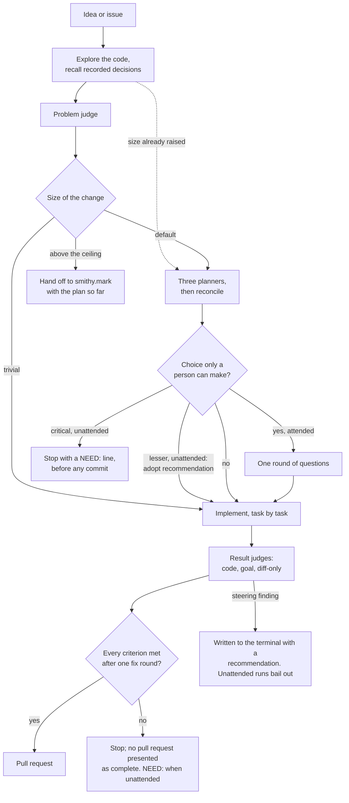

# RFC: Strike Redesign

**Created**: 2026-11-21  |  **Status**: Draft

## Summary

This RFC proposes redesigning `smithy.strike` so that one command takes an idea or a GitHub issue to a pull request containing the change and its tests. It asks a person at most one round of questions before any code is written, comes back afterwards only when a result judge finds something only they can settle, and brings independent judgment to the problem, the plan and the result. Without the redesign, direct work stays outside Smithy: the maintainer has already stopped using strike, and an orchestrator that needs a patch from an issue has no Smithy command that can produce one.

## Motivation / Problem Statement

`smithy.strike` is Smithy's command for work done directly, without a spec, and its maintainer has stopped using it. A run makes seven sub-agent calls, six of them on the deep tier. The result is a twelve-section planning document in a pull request of its own, and the code itself needs a second command, `smithy.forge`, and a second pull request. The one recorded run took 8 minutes 11 seconds and cost $2.45 before any code existed. Strike also never stops to ask, so a misread request comes to light only when someone reads the finished document. Plan mode followed by a dispatch, or the Superpowers planning skills, get the maintainer to working code sooner and give them more say over the direction, so those are what they use.

The price is that direct work now gets none of what Smithy adds everywhere else. That work runs from changing the colour of a button to a pull request of notable size that still does not justify a spec. None of it gets independent planners working from different angles, which the maintainer counts among the most notable improvements to plan quality the project has made. None of it gets recall of the repository's recorded decisions and invariants. And none of it gets the rule that separates a choice only a person can make from a detail the code will settle. The longer strike goes unused, the more of the repository's day-to-day change goes through tools that know nothing of these commitments.

A second consumer is now waiting on the same gap. The [issue-triage RFC in the March project](https://github.com/Balexda/March/blob/main/docs/rfcs/2026-003-issue-triage/issue-triage.rfc.md) sends accepted small issues to strike as its small-patch path. It would replace the hand-written prompt that its issue workers follow today, and it expects a patch pull request that links back to the issue. Those workers run with no person present. They may stop and escalate, but they must not guess and must not hand back a partial patch. Strike cannot serve them as it stands: it produces a document where a patch is expected, it takes no issue as input, and it has no way to stop and ask. The goal is one command that takes an idea or an issue to a pull request containing the change, asks only when a real choice exists, and judges the problem, the plan and the result independently, at a cost in proportion to the size of the change.

## Goals

- **One command takes an idea or an issue to a pull request with code.** A single `smithy.strike` run, in one session, ends with a pull request holding the change and its tests. Nothing in that pull request is a planning document, and no planning document is committed to the repository or to an external artifact store.
- **A GitHub issue is a first-class input.** Strike accepts an issue as well as a description in words, and the pull request it produces for an issue links back to that issue.
- **A person is asked only when it matters.** When the request leaves a choice only a person can make, strike asks one round of questions before any code is written. A run with nothing to decide asks nothing. Once code exists, the run returns to the person only when a result judge finds something only they can settle: a criterion still unmet after one fix round, or a steering finding, written to the terminal with a recommendation.
- **The problem, the plan and the result each get an independent judge.** The request is read with no plan in sight. Three planners work from different angles without seeing each other's work, and a reconciler merges what they propose. The finished change is checked against its task, against the original request alone, and by a reader with no background at all. Each judge's independence comes from what it is given. Agreement between judges never raises confidence in a finding, and a failing test outranks any reviewer. An agent that cannot run separate judges runs the same stages inline and says in its output and in the pull request that no independent review ran.
- **Cost follows the size of the change.** Every stage runs by default. The planning panel, and with it the diff-only reviewer, is skipped only for a change that is truly trivial, and that decision waits until the problem has been judged. The caller or the evidence can raise the size, but nothing can lower it. A change that has outgrown one pull request is handed to `smithy.mark` with the plan so far, so strike does not stretch to fit it.
- **An orchestrator can run strike unattended and trust how it ends.** Unattended running is an explicit choice by the caller and is never inferred. Every unattended run ends in exactly one of two states. In the first, a complete patch meets every acceptance criterion and lists each choice that was made without a person. In the second, a one-line `NEED:` stop names what is still open. An unattended run never guesses on a critical choice and never hands back a partial patch.
- **The pull request carries what a reviewer needs from the plan.** Its description records the decisions taken, the alternatives turned down, a verdict on each acceptance criterion and the validation result. A reviewer does not need a separate planning document to see why the change looks the way it does.
- **A long or interrupted run knows where it is.** Strike keeps its working plan in a file that a compacted or resumed run can re-read. That file never shows up as a change in the repository or in the pull request diff, is kept away from the judges who must not see it, and is removed once the pull request is open.
- **Strike and forge share one implementation procedure.** Strike and `smithy.forge` use the same implement, review, documentation-check and validate procedure, kept in one place, so a change to it is made once and reaches both commands. Existing `.strike.md` files keep working with `smithy.forge` as they do today.

## Out of Scope

- **Changes to how `smithy.forge` behaves, including its tracked-checklist completion check.** Strike reuses forge's sub-agents and its shared procedure, but forge itself works exactly as it does today.
- **Adding the goal reviewer or the diff-only reviewer to `smithy.forge`.** These reviewers ship in strike first, and whether forge adopts them is a separate decision once strike has been run with them.
- **A validator agent, or a panel of voters, for each review finding.** The cost is out of proportion to a single pull request, and the test suite plus the single fix round serve as the check.
- **Migrating, converting or deleting existing `.strike.md` files.** They stay where they are and remain usable with `smithy.forge`.
- **Changes on the orchestrator's side, such as the March project's issue-triage work.** This RFC handles cross-project sequencing only. Amending the orchestrator's own documents and conventions is that project's job.
- **Changes to `smithy.fix`.** It stays the command for repairing a pull request after it opens and needs no planning artifact from strike to do that.

## Personas

**Maintainer.** The maintainer does direct work between pipeline runs. They have stopped using strike because it is slower and yields a document instead of code, so they plan in plan mode or with the Superpowers skills, and that work gets no competing plans, no recall of the repository's recorded decisions and no steering questions. With this RFC, one command takes their idea to a pull request with the change and its tests, asks them at most one round of questions before any code is written, and brings back the independent planners and judges they have been doing without.

**Unattended Orchestrator Worker.** This worker runs an orchestrator's issue-triage route, such as the March project's, with no person present. It follows a hand-written prompt today because strike yields a document, takes no issue as input and cannot stop to ask. With this RFC it can give strike an accepted small issue and get one of two outcomes: a patch pull request that meets every acceptance criterion and links back to the issue, or a one-line `NEED:` stop that names the open choice, never a guess or a partial patch.

**Installed-Base Team.** These teams run `/smithy.strike` for small features and already hold `.strike.md` files from earlier runs. Today a strike run gives them a planning document, and they need a second command and a second pull request to get any code. With this RFC one command gives them a pull request containing the code, and the `.strike.md` files they already have keep working with `smithy.forge`.

**Template Author.** The template author maintains the implement, review and validate procedure that forge runs and that strike now needs too. Without this RFC they would keep two copies of that procedure in two commands, and the copies would drift apart. With this RFC the shared procedure lives in one place that both commands use, so a change to it is made once and reaches both.

## Proposal

`/smithy.strike` takes an idea in words or a GitHub issue and ends with a pull request that holds the change and its tests. It does this in one command and one session. Nothing in that pull request is a planning document, and no planning document is committed anywhere. The run explores the code and recalls the repository's recorded decisions and invariants. It then hands the request to the problem judge, `smithy-clarify`, with no plan in sight. Only after that judge returns does strike decide how big the change is, so a change that looks trivial waits for the problem judge before the panel is skipped. The three-lens plan panel runs alongside the problem judge only when the caller or the evidence has already raised the size. Implementation runs task by task through forge's implementation, review and documentation-check sub-agents, which strike dispatches itself. The result judges then read the finished change. Independence comes from what each judge is given, as the table sets out.

| Stage | Judge | Given | Withheld | Runs |
|---|---|---|---|---|
| Problem | `smithy-clarify` | The request verbatim, relevant file paths, recalled records | Any plan | Always, and first |
| Plan | Three `smithy-plan` lenses (Simplification, Separation of Concerns, Robustness), then `smithy-reconcile` | The request, file paths, recalled records | Each other's output | After the problem judge unless the change is trivial; alongside it when the size is already raised |
| Result | Code reviewer (`smithy-implementation-review`) | The change and the task brief | Nothing relevant | Always |
| Result | Goal reviewer (new) | The request verbatim, the acceptance criteria, the change | The plan, the tasks, other reviewers' findings | Always |
| Result | Diff-only reviewer (`smithy-implementation-review` under a diff-only dispatch profile) | The change and the repository | The plan, the tasks, the request | When the plan panel ran |

Before any code is written, a person is asked at most once. When the problem judge or the panel surfaces a choice only a person can make, strike asks one round of questions in the main session, each with a recommendation. A run with nothing to decide asks nothing. Once code exists the run comes back to the person in two cases only. One is an acceptance criterion still unmet after one fix round. The other is a steering finding that a result judge raises after the question round. In an attended run that finding is written to the terminal with a recommendation, and the operator decides. In an unattended run it bails the run out with a message that says why.

The amount of work follows the change. The size can be raised by the caller or by evidence, and is never lowered.

| Size | When | What runs |
|---|---|---|
| Default | Anything that is not trivial and fits under the ceiling | Every stage: problem judge, plan panel and reconcile, the question round if needed, implementation, all three result judges |
| Trivial | One task, no change to an interface, schema or stored format, no conflict with a recalled record, and no question for a person | The problem judge, implementation, the code reviewer and the goal reviewer. A steering question from the problem judge brings the panel back |
| Above the ceiling | The change no longer fits one pull request, or needs a spec | Strike stops and hands the plan so far to `smithy.mark`. This replaces today's "more than about five tasks" rule that points at `smithy.ignite` |

The run's memory is a working plan file in the working tree that git ignores. It holds the request, the acceptance criteria, the decisions taken with the alternatives turned down, the choices made without a person, and the tasks with their status. Strike re-reads it at each phase, so a compacted or resumed run knows where it is. The file never shows up in `git status` or in the pull request diff. Before the result judges run it is cut down to the request, the criteria and the decisions, which here include the alternatives turned down and the choices made without a person, subject to the probe described under Design Considerations. It is deleted once the pull request is open, and kept when the run stops or hands off. The pull request description is drawn from this file. It records the decisions taken, the alternatives turned down, a verdict on each acceptance criterion and the validation result. For an issue it links the issue. For an unattended run it also lists every choice made without a person.

An orchestrator can run strike unattended with an explicit flag, which is never inferred. Issue input is built together with this mode, since both serve the orchestrator. An unattended run ends in exactly one of two states. One is a complete patch that meets every acceptance criterion and lists the choices made without a person. The other is a one-line `NEED:` stop that names what is open, written to the session with strike's recommendation so the operator can decide. A critical open choice stops the run before any commit. A lesser one adopts the recommended option. A run that stops after commits exist pushes nothing and opens no pull request, so it never hands back a partial patch. That stop is reported as the `NEED:` line, naming what is unmet or open, why the run stopped, and the re-invocation that resolves it. A steering finding raised by a result judge is one such stop. On an orchestrated run strike opens the pull request itself, and a patch-only mode is added later only if the orchestrator turns out to need one. Strike writes nothing to GitHub except the pull request, so an open choice is never posted as a comment on the issue. On an agent with no sub-agents, such as Gemini CLI, strike runs the same stages inline. It says in its output and in the pull request that no independent review ran.

## Design Considerations

**Strike stays in the main session (D-4).** D-4 holds strike out of `context: fork` because "explore what we just discussed, then strike it" is its defining use. The question round also needs the main session, since a sub-agent or a fork cannot ask the user anything. Unattended running is a flag on the same in-context command, not a fork, so D-4 is not superseded. The `NEED:` stop takes the shape of D-4's terminal bail-out: it names what is open and the re-invocation that resolves it.

**One home for the shared procedure and for review triage (INV-1).** The implement, review, documentation-check and validate procedure moves to one place that forge and strike both compose, and forge's behaviour does not change. Today the implementation sub-agent counts a task as done only when a committed checkbox flip lands with it. Strike therefore needs a form where progress lives in the untracked plan file, and forge must never select that form. The judges compose the existing review protocol and kind gate. Withholding inputs is a dispatch difference, not a protocol variant, so it needs no ledger row. Only a genuine strike variant of review triage or of the terminal output earns a Known Exceptions row on INV-1.

**Deployed text names no project-specific orchestrator, PRD or issue (INV-2).** The orchestrator is described generically in every deployed template, even though March's issue-triage route is the first consumer. The plan file's location and the way it is ignored must work in a fresh repository. The ignore mechanism is fixed by a criterion: the file never appears in `git status` or in the pull request diff of a fresh repository. That rules out appending to the repository's root ignore file, because the edit would land in strike's own pull request. A self-ignoring directory is the stated preference.

**New sub-agent metadata (INV-3).** The goal reviewer declares a provider-neutral `tier`. It does not rely on `effort` while INV-3's Temporary row stands, because Claude drops that key today. Making the diff-only reviewer a dispatch profile of the existing code reviewer adds no new agent metadata at all.

**Strike's own body is a budget (P-1).** Strike's deployed body is about 8.9k tokens, as D-4 records. Composing the shared procedure will grow it. Dropping the twelve-section document template and the plan-review block offsets part of that growth. The body is measured before and after, and a ceiling is recorded as a success criterion. Rarely-used material, such as the unattended path and the hand-off to `smithy.mark`, stays short.

**Same-model judges overlap, so agreement is not evidence.** Judges on one model share many of their findings and can be wrong together. Agreement between judges therefore never raises confidence in a finding. A failing test outranks any reviewer, and the parent checks what a judge reports before acting on it. Eval cases measure how far the goal reviewer's findings overlap the code reviewer's. If a design choice hidden in a one-file change gets through, the trivial rule is tightened.

**Two unknowns are settled by probes, not by a person.** Each probe is a success criterion on the work it gates. The first probe asks whether a git-ignored plan file in the working tree stays out of reach of both context-limited result judges on Claude and on Codex. Claude's file-name search does not honour ignore rules by default. The diff-only reviewer is given the repository, so cutting the file down does not protect it. If the probe fails, the file is deleted before those judges run, or moved out of the tree. A move needs per-agent permission work and becomes new debt. The second probe asks whether a sub-agent on every supported runtime starts with only its dispatch, and every "withheld" cell depends on it. If a Codex sub-agent inherits context, Codex is recorded as degraded like Gemini and says no independent review ran.

**The call-count targets assume no plan review.** The targets are 6 sub-agent calls with 4 on the deep tier for a trivial fix, and 14 for a four-task change. SD-001 settled that `smithy-plan-review` does not run on the working plan, so neither count includes it. Plan errors are left to the result judges, which check the outcome in the form it actually takes.

**Cross-project sequencing is a coordination note, not a dependency.** March's issue-triage RFC says its strike milestone has "No Smithy stage changes" and describes the route as producing "a strike plan". Both need amending on March's side, and its expectations of branch name and pull-request title need reconciling with what strike produces. This is recorded as an entry condition on the unattended and issue-input work, never as a `Depends On` edge. Which side moves first is the maintainer's call, and they may make it independently of this RFC's order.

## Decisions

- **Build it from Smithy's own parts; adopt no external tool.** The PRD's survey found the closest outside shape in a plugin with competing architects followed by several reviewers, which runs on one agent and waits on a person throughout. What is borrowed is mechanism: reviewers made independent by what they are given, review depth that follows the change and is only ever raised, and the rule that agreement on one model is not corroboration.
- **The PRD's critical assumptions are settled and are not reopened here.** They were decided with the maintainer on 2026-11-21: the result is a pull request with code and no committed plan, independence comes from withholding inputs, the panel runs by default under a raise-only trivial rule, forge and strike share one procedure with forge unchanged, the working plan is a git-ignored file, questions come in one round before code, and unattended running is an explicit flag with a `NEED:` stop.
- **The plan panel stays.** The maintainer's experience is that competing plans were among the most notable improvements to plan quality in Smithy, and the value is the independent viewpoints. No measurement of the panel's effect exists in this repository, so the decision rests on that experience.
- **The problem judge runs first and the size decision follows it.** The PRD drew the two side by side, but its own rule that a trivial-looking change waits for the problem judge settles the order. The panel runs alongside the problem judge only when the size is already raised.
- **Strike stays un-forked, unattended is a flag, and D-4 stands.** The question round needs the main session, and the `NEED:` stop supplies the terminal bail-out D-4 asks of a command that cannot ask.
- **Strike dispatches forge's sub-agents; it does not hand a plan to forge.** The model cannot start a Smithy command, so a hand-off would still take two commands, and forge's completion check reads a tracked checklist that an untracked plan cannot satisfy.
- **The shared procedure is extracted before strike is rewritten.** Forge parity is a contract that can be verified on its own, and a forge regression stays isolated from the strike work. A temporary copy inside strike would break INV-1.
- **The goal reviewer is the one new agent; the diff-only reviewer is a dispatch profile of the code reviewer.** The code reviewer already takes a review profile, and a profile adds no agent metadata.
- **The working plan file owns the run's record.** The request, the criteria, the decisions with the alternatives turned down, the choices made without a person and the task status live there, and the pull request description is drawn from it. One owner survives compaction and keeps the stages from holding separate records.
- **The ignore mechanism is fixed by a criterion, not copied from ignite.** Ignite ignores its clarify logs by appending to the repository's root ignore file. In strike that edit would land in the pull request, so the criterion is that the plan file never appears in `git status` or in the diff of a fresh repository.
- **Probes are success criteria on the work they gate.** A probe has an answer to find, not a choice for a person, so it is neither debt nor a body of work of its own. RFC 2026-002 set the precedent. If a probe fails in a way that leaves a choice, that choice is recorded as new debt then.
- **Judge independence is measured, not argued.** Eval cases record how far the goal reviewer's findings overlap the code reviewer's, with a planted defect and with a design choice hidden in a one-file change.
- **Issue input travels with unattended mode.** Both serve the orchestrator worker and share the issue-link and permission criteria.
- **An unattended run that stops after commits exist pushes nothing and opens no pull request.** This follows from the rule that a worker must not hand back a partial patch.
- **Cross-project sequencing is an entry condition, never a dependency edge.** The orchestrator's own RFC is amended on its side, and which side moves first is the maintainer's call.
- **No validator agent, and the new judges ship in strike only.** The test suite and the single fix round are the check on review findings. Whether forge adopts the goal and diff-only reviewers is decided after strike has run with them.
- **All four steering choices are resolved in this RFC.** SD-001 to SD-003 came from the PRD and SD-004 was found here. The maintainer decided them on 2026-11-21 and they are recorded under Specification Debt. None is passed down as open debt.
- **Plan review does not run on the working plan.** Nothing ships from that file, and the result judges check the outcome in the form it actually takes.
- **Strike opens the pull request on an orchestrated run.** No patch-only mode is built. One is added later only if the orchestrator turns out to need it.
- **An open choice is written to the session with a recommendation, and the operator decides.** Strike never posts it as a comment on the issue, so the pull request stays the only thing strike writes to GitHub.
- **A steering finding raised after the question round goes to the terminal when a person is present, and bails the run out when none is.** The bail-out message says why.
- **Engraving is a follow-up.** The stances this RFC sets, that strike's result is a pull request and that no plan is committed, are candidates for `smithy.engrave` once the RFC is accepted. D-4 is not in conflict and needs no change.

## Specification Debt

All four items are resolved. SD-001 to SD-003 were first recorded in the source PRD, `docs/prds/2026-003-strike-redesign.prd.md`, which still lists them as open.

| ID | Title | Source Category | Impact | Confidence | Origin |
|----|-------|-----------------|--------|------------|--------|

### Resolved

#### SD-001 — plan-review-on-working-plan

**Question:** Should strike run `smithy-plan-review` on the working plan before implementation, or leave it out? Keeping it costs one deep-tier call on every run that plans, and raises the four-task call count from 14 to 15. Dropping it leaves plan errors to the result judges.

**Answer:** Resolved 2026-11-21 — leave it out. The maintainer agreed with the recommendation: nothing ships from the working plan, and the result judges check the outcome in the form it actually takes. The call-count targets stand at 6 for a trivial fix and 14 for a four-task change.

#### SD-002 — orchestrated-run-pr-ownership

**Question:** For an orchestrated run, should strike open the pull request itself, stop at commits with a hand-off record for the orchestrator's session to open, or support both with the caller choosing?

**Answer:** Resolved 2026-11-21 — strike opens the pull request. The maintainer agreed with the recommendation. No patch-only mode is built, and one is added later only if the orchestrator turns out to need it.

#### SD-003 — unattended-question-channel

**Question:** When an unattended run meets a critical open choice, should it stop with a `NEED:` line only, or also post the question as a comment on the originating issue?

**Answer:** Resolved 2026-11-21 — the open choice is written to the session together with strike's recommendation, and the operator decides. Nothing is posted on the issue. In an unattended run this is the `NEED:` stop, which carries the recommendation alongside what is open.

#### SD-004 — post-question-steering-finding-home

**Question:** When a result judge raises a `steering` finding after the single question round, there is no target artifact and no second round is allowed, so where does it go? The choices are to list it in the pull request description as an open decision for the reviewer, to treat it as a stop like an unmet criterion, or, in unattended mode, to adopt the recommendation or stop with `NEED:` when it is critical. A stop at this point comes after commits exist.

**Answer:** Resolved 2026-11-21 — in an attended run the finding goes to the terminal, with a recommendation, for the operator to decide. In an unattended run it triggers a bail-out with a message that says why. That holds for every such finding, not only critical ones, and the bail-out pushes nothing and opens no pull request.

## Milestones

### Milestone 1: Shared Implementation Procedure

**Description**: Moves the implement, review, documentation-check and validate procedure that `smithy.forge` runs today into one home that forge and strike both compose. The procedure names no single artifact type. Where progress is recorded and what the review targets become inputs to the procedure. Forge's own completion checks stay in forge: the slice completion check and the story completion cascade still read the tracked checklist. `smithy-implement`, `smithy-implementation-review` and `smithy-maid` gain an untracked-plan form, which strike will select and forge never selects. In that form a task counts as done without a committed checkbox flip, and progress lives in the working plan file. Forge's behaviour does not change. This milestone has no dependencies, and no open debt item needs settling before it begins.

**Success Criteria**:
- Forge's deployed body on Claude, Gemini and Codex carries the same instructions before and after the move, and an automated check asserts it.
- An existing `.strike.md` still forges to a pull request, with the same slices, commits and checklist flips as before. An existing `.tasks.md` slice also forges as before.
- Forge's completion check still refuses to finish a slice while any tracked task row is unchecked at the branch head.
- The shared procedure is written once. No command restates it, and the template lint passes.
- In the untracked-plan form, `smithy-implement` reports a task as a success when its code-and-test commit lands, with no checkbox flip in that commit.
- In the untracked-plan form, no plan file is ever staged or committed, including through a forced add, and the plan file never appears in any commit the sub-agents produce.
- In the untracked-plan form, `smithy-maid` treats the request and the working plan as its authoritative source, and `smithy-implementation-review` reviews against the task brief from the working plan.
- A test shows that forge never selects the untracked-plan form, on any agent and in any of forge's modes.

### Milestone 2: Context-Limited Result Judges

**Description**: Delivers the two result judges strike adds, and runs the two probes that every "withheld" cell in the judges table depends on. The goal reviewer is the one new sub-agent. It is given the request verbatim, the acceptance criteria and the change, and it is withheld the plan, the tasks and the other reviewers' findings. The diff-only reviewer is a dispatch profile of `smithy-implementation-review`: it is given the change and the repository, and withheld the plan, the tasks and the request. Both report through the existing review protocol and kind gate. The probes settle two questions before strike relies on the judges. The first is whether a git-ignored plan file in the working tree stays out of reach of both judges. The second is whether a sub-agent starts with only what its dispatch gives it. This milestone has no dependencies and can start alongside Milestone 1, and no open debt item needs settling before it begins.

**Success Criteria**:
- The goal reviewer declares a provider-neutral tier and does not rely on an effort setting. Given a change and its acceptance criteria, it returns a verdict on each criterion and never asks for the plan or the tasks.
- `smithy-implementation-review` under the diff-only profile reviews a change with no slice goal, no tasks and no request. Its existing profiles and its forge dispatch behave as before.
- Both judges return findings with a `kind` and a routed `destination` in the existing review protocol's shape. No judge restates triage. Agreement between judges never raises a finding's confidence.
- The first probe has been run on Claude and on Codex against both judges, with a git-ignored plan file present in the working tree, and its result is recorded for each runtime and each judge.
- The first probe's outcome fixes what strike does with the plan file before the result judges run. If neither judge can reach the file, it is cut down to the request, the criteria and the decisions. If either judge can reach it, it is deleted before the judges run. If deletion would lose state the run still needs, the file moves out of the tree instead, and that move is recorded as new debt for the per-agent permission work it requires.
- The second probe has been run on Claude and on Codex, and its result is recorded. If a Codex sub-agent inherits context beyond its dispatch, Codex is recorded as degraded like Gemini, and strike on Codex is required to say that no independent review ran.
- Forge dispatches neither new judge.
- No deployed text for either judge names a specific orchestrator, PRD or issue, and both descriptions stay within the description budget the template lint enforces.

### Milestone 3: Interactive Strike From Idea to Pull Request

**Description**: Rewrites `smithy.strike` so that one interactive run, in the main session, takes an idea in words to a pull request holding the change and its tests. The run explores the code and recalls recorded decisions, then hands the request to `smithy-clarify` as the problem judge with no plan in sight. Only then does it decide the size. The three-lens panel and `smithy-reconcile` run unless the change is trivial. Strike asks at most one round of steering questions before any code. It implements task by task through the Milestone 1 procedure in its untracked-plan form, then runs the Milestone 2 judges and allows one fix round. A git-ignored working plan file is the run's record, and the pull request description is drawn from it. A change above the ceiling is handed to `smithy.mark`. No `.strike.md` is written. The existing strike eval case, its baseline and the source-tree docs change in this milestone, because this is where strike's output changes. `smithy-plan-review` does not run on the working plan, as SD-001 settled. This milestone depends on Milestones 1 and 2.

**Success Criteria**:
- A run from an idea in words ends with one pull request that contains the change and its tests. No `.strike.md` is written, and no planning document appears in the pull request or is committed anywhere.
- In a freshly initialised repository, the working plan file never appears in `git status` or in the pull request diff, and keeping it ignored makes no tracked edit to any ignore file. A branch name containing `/` still maps to a single plan file.
- The plan file is re-read at the start of every phase. A run started again on a branch whose plan file exists resumes from the recorded task status and does not start over. Before the result judges run, the file is cut down or removed as the Milestone 2 probe decided. It is deleted after the pull request opens, and kept when the run stops or hands off.
- An interactive run asks at most one round of questions before the first commit, each with a recommendation. It asks none when nothing needs a person. A steering finding that a result judge raises afterwards is written to the terminal with a recommendation for the operator to decide, and is never adopted silently.
- The problem judge always returns before the size is decided. A change is trivial only when it is one task, alters no interface, schema or stored format, conflicts with no recalled record, and raises no question for a person. A trivial run skips the panel and the diff-only reviewer. A steering question from the problem judge brings the panel back. A size raised by the caller or by evidence is never lowered.
- A change that no longer fits one pull request, or needs a spec, stops before any code and is handed to `smithy.mark` with the plan so far. Started from that hand-off, `smithy.mark` produces a spec without asking for the request again. The old "more than about five tasks" pointer to `smithy.ignite` is gone.
- The code reviewer and the goal reviewer run on every run, and the diff-only reviewer runs on every run where the panel ran. The pull request description records the decisions taken, the alternatives turned down, a verdict on each acceptance criterion and the validation result. A criterion still unmet after one fix round stops the run, and no pull request is presented as complete.
- On Gemini CLI the same stages run inline. Both the run's output and the pull request say that no independent review ran. Codex says the same if the Milestone 2 probe recorded it as degraded.
- Strike's deployed body is measured before the change (about 8.9k tokens today) and after it. A ceiling is recorded, and the new body stays within it. The existing strike eval case and its baseline are updated to expect a code pull request in place of a document, and they pass.
- Legacy `.strike.md` surfaces do not regress: forge's strike mode, status discovery, the strike audit checklist, resolve and session titling all behave as before on an existing `.strike.md`. `smithy.fix` repairs review feedback on a strike-opened pull request without needing any planning artifact.

### Milestone 4: Issue Input and Unattended Mode

**Description**: Adds a GitHub issue as an input to strike, together with an explicit unattended flag, so an orchestrator's worker can hand strike an accepted small issue with no person present. An unattended run never asks. It stops with a one-line `NEED:` on a critical open choice, adopts the recommendation on a lesser one, and lists every choice it made without a person. It ends in exactly one of two states, and never in a guess or a partial patch. Strike opens the pull request itself on an orchestrated run, as SD-002 settled. A stop writes what is open to the session with strike's recommendation and posts nothing on the issue, as SD-003 settled. A steering finding that a result judge raises after the question round bails the run out with its reason, as SD-004 settled. Entry condition: the maintainer has decided the cross-project order with the March project's issue-triage RFC before this work starts. That RFC's strike milestone says "No Smithy stage changes" and its rubric describes the route as producing "a strike plan", and its branch-name and pull-request-title expectations need reconciling with what strike produces. That coordination is an entry condition and is never drawn as a dependency. This milestone depends on Milestone 3.

**Success Criteria**:
- Strike accepts a GitHub issue as its input and takes the request and the acceptance criteria from the issue. When the issue states no criteria, the criteria strike derives are listed in the pull request. The pull request links the issue.
- On every agent where Smithy deploys permissions, reading the issue needs no grant beyond what `smithy init` installs.
- A run is unattended only when the caller passes the explicit flag. Issue input, a missing terminal and an orchestrator-shaped request never switch it on by themselves.
- An unattended run never asks the user a question.
- Every unattended run ends in exactly one of two states. The first is a complete patch that meets every acceptance criterion, links its issue and lists every choice made without a person. The second is a single `NEED:` line that names what is open and the re-invocation that resolves it, written to the session with strike's recommendation.
- A critical open choice found before implementation ends the run with `NEED:` before any commit. A lesser one adopts the recommended option and is listed in the pull request as decided without a person.
- When an unattended run stops after commits exist, whether on a criterion still unmet after the fix round or on a steering finding raised by a result judge, nothing is pushed and no pull request is opened. That stop is reported as the single `NEED:` line, naming what is unmet or open, why the run stopped, and the re-invocation that resolves it.
- On an orchestrated run strike opens the pull request itself. No patch-only mode exists. Strike writes nothing to GitHub except the pull request, and an open choice is never posted as a comment on the issue.
- No deployed text names a specific orchestrator. Strike's deployed body stays within the ceiling recorded in Milestone 3, and the updated strike eval case and its baseline still pass.

### Milestone 5: Evidence: Call Counts and Judge Independence

**Description**: Turns the cost and independence claims into evals that can be observed. It counts sub-agent calls by tier on a trivial fix and on a four-task change, and measures whether the goal reviewer adds anything the code reviewer does not, using a planted defect and a design choice hidden inside a one-file change. If the hidden choice gets through, the trivial rule is tightened. Cost is counted in calls by tier; no time or token target is set. The call-count targets assume no plan review on the working plan, as SD-001 settled. This milestone depends on Milestone 3. Its unattended `NEED:` case needs Milestone 4's unattended mode and is added once that lands; that need is not drawn as a dependency.

**Success Criteria**:
- On a one-file fix with nothing to decide, one strike command makes 6 sub-agent calls, 4 of them on the deep tier, and ends in a code pull request. Today strike followed by forge takes 10 calls (8 deep) across two commands and two pull requests.
- On a four-task change with a real design choice, strike makes 14 sub-agent calls, against 13 today for strike followed by forge.
- Neither count includes `smithy-plan-review`, and the evals assert that strike never dispatches it.
- In a planted-defect case, a defect that the existing tests do not catch is placed in the change. The eval records whether the code reviewer and the goal reviewer each report it, and a run whose tests fail never presents its pull request as complete.
- In a hidden-design-choice case, a one-file change conceals a choice only a person can make. The run either raises a steering question or raises the size and brings the panel back. If the choice gets through, the trivial rule is tightened and the case passes on a rerun.
- Across the eval runs, the share of the goal reviewer's findings that the code reviewer also reported is measured and recorded as a baseline.
- Once Milestone 4 lands, an unattended case on a fixture issue with a critical open choice ends in a single `NEED:` line, with no commit, no push and no pull request.
- Every new case runs in the existing eval framework with a committed baseline.

## Dependency Order

Recommended implementation sequence:

| ID | Title | Depends On | Artifact |
|----|-------|------------|----------|
| M1 | Shared Implementation Procedure | — | docs/rfcs/2026-003-strike-redesign/01-shared-implementation-procedure.features.md |
| M2 | Context-Limited Result Judges | — | — |
| M3 | Interactive Strike From Idea to Pull Request | M1, M2 | — |
| M4 | Issue Input and Unattended Mode | M3 | — |
| M5 | Evidence: Call Counts and Judge Independence | M3 | — |
