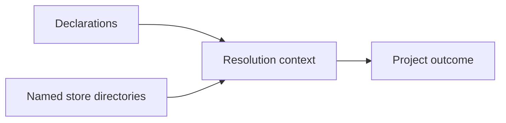

# Data Model: Declared Project Resolution

## Entities

### Declaration

| Field | Type | Required | Validation |
|-------|------|----------|------------|
| value | string | Yes | Nonempty ASCII letters, digits, `.`, `_`, `-`; not `.` or `..`; exact `default` reserved |
| source | option / artifact | Yes | Supplied input only |
| artifact | path | For artifact | One document-level Project header; no fenced examples |

Header normalization: trim surrounding whitespace and remove one enclosing backtick pair before validating. Preserve case. An empty supplied value is invalid, not absent. Multiple headers are invalid even if equal.

### Resolution Context

| Field | Type | Required | Meaning |
|-------|------|----------|---------|
| mode | repo / external | Yes | Effective install mode |
| repositoryKey | string or absent | No | Existing repository-store identity, stable across worktrees; absent without a repository identity |
| declarations | zero to two Declarations | Yes | At most one from each source |
| namedStores | sorted unique string list | Yes | Valid non-reserved directory names under the named-project root |

### Project Outcome

| Tag | Payload | Meaning |
|-----|---------|---------|
| selected | slug, source: option / artifact / agreement / repository | Resolved identity |
| none | none | No declared/inherited project and fewer than two candidates |
| candidates | names | Two or more named stores; no selected project |
| invalid-project | value, source, reason | Invalid syntax or reserved name |
| project-conflict | optionValue, artifactValue | Valid declarations disagree |
| project-missing | slug, source | Declared named directory does not exist |
| invalid-artifact | artifact, reason | Unreadable artifact or malformed/duplicate header |

All entities are transient; no persisted schema or registry is introduced. Directory existence, rather than git history or contents, defines a named project's existence. Inherited identity is not subject to the named-directory existence check and does not change engraved scope.

## Relationships

| Relationship | Cardinality |
|--------------|-------------|
| Context to declarations | 1 : 0..2 |
| Context to outcome | 1 : 1 |
| Candidate outcome to names | 1 : 2..N |

## State Transitions

| Input condition, evaluated in order | Outcome |
|-------------------------------------|---------|
| Artifact cannot be read or header is malformed/duplicated | invalid-artifact |
| Any supplied declaration invalid/reserved | invalid-project |
| Two valid declarations differ | project-conflict |
| Declaration chosen, named directory absent | project-missing |
| Declaration chosen, named directory present | selected with declaration provenance |
| No declarations, external mode, repository identity available | Validate inherited key, then selected/repository or invalid-project |
| No declarations/inheritance, at least two named stores | candidates |
| Otherwise | none |

## Identity & Uniqueness

| Identity | Rule | Example |
|----------|------|---------|
| Named project | Exact case-preserved directory name | `fleet-sync` |
| Inherited project | Existing repository-store key | Main checkout `service` and worktree `fix-123` both yield `service` |
| Reserved store | Exact `default` excluded from user projects | `--project default` refuses |
