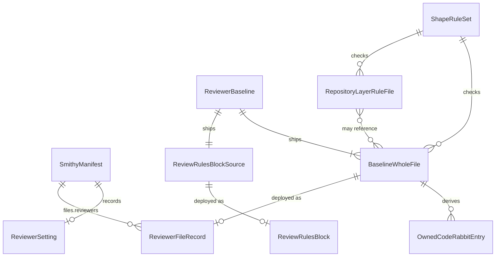
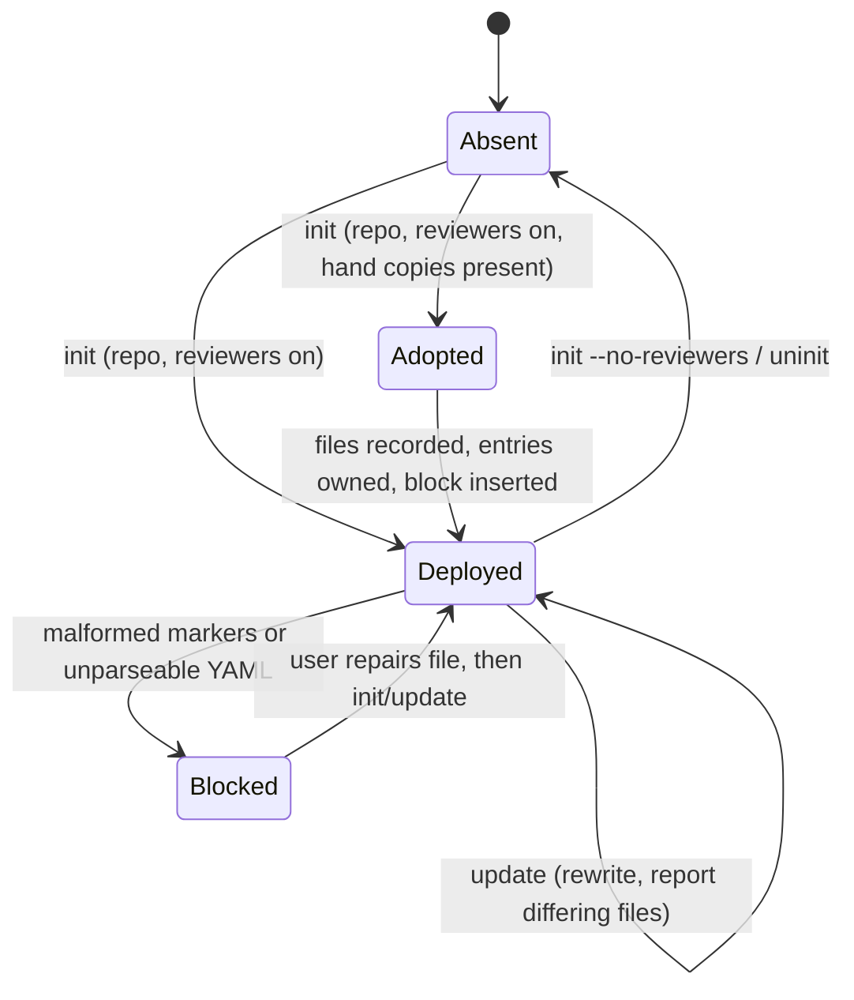

# Data Model: Reviewer Baseline Deployment and Setup Skill
<!-- applicability: code-shaped features only -->

## Entities
<!-- audience: builder; mode: reference; length: tables only; diagram: required; examples: recommended; applicability: code-shaped features only -->

### 1) Reviewer Setting (`SmithyManifest.reviewers`)

| Field | Type | Required | Notes |
|-------|------|----------|-------|
| `reviewers` | `true` | No | Present only when the baseline is deployed. Absent means off, which keeps pre-feature manifests byte-identical. |

Validation rules:
- Written as `true` or omitted. Never written as `false`.
- At user location it is never written by default (FR-002). Explicit `--reviewers` at user location is unresolved (SD-001).

### 2) Reviewer File Record (`SmithyManifest.files.reviewers`)

| Field | Type | Required | Notes |
|-------|------|----------|-------|
| `files.reviewers` | `string[]` | No | Repo-relative paths of the deployed baseline whole files. Present only when `reviewers` is `true`. |

Validation rules:
- The key `reviewers` is reserved and is never an agent name.
- It lists whole files only. `AGENTS.md` and `.coderabbit.yaml` are never listed, because stale cleanup and uninit delete every listed path.

### 3) Reviewer Baseline (shipped source)

| Field | Type | Required | Notes |
|-------|------|----------|-------|
| `wholeFiles` | `BaselineWholeFile[]` | Yes | Exactly the inventory below. |
| `blockSource` | `ReviewRulesBlockSource` | Yes | Text placed between the `AGENTS.md` markers. |

Inventory (deployed path → kind):

| Deployed path | Kind | `applyTo` source |
|---------------|------|------------------|
| `.github/instructions/smithy.review-stance.instructions.md` | instruction | own frontmatter (`**`) |
| `.github/instructions/smithy.planning-artifacts.instructions.md` | instruction | own frontmatter (planning suffix globs) |
| `.github/skills/smithy-review-planning/SKILL.md` | skill | each instruction file that names the skill |

Validation rules:
- Every deployed path begins with an owned prefix: `.github/instructions/smithy.` or `.github/skills/smithy-`.
- Content passes the portability check (FR-020) and the shape rules (FR-019).

### 4) Baseline Whole File

| Field | Type | Required | Notes |
|-------|------|----------|-------|
| `path` | `string` | Yes | Deployed repo-relative path. |
| `kind` | `'instruction' \| 'skill'` | Yes | |
| `frontmatter.applyTo` | `string` | instruction only | Comma-separated globs, copied verbatim. |
| `frontmatter.excludeAgent` | `'code-review' \| 'coding-agent'` | No | Copied verbatim. |
| `frontmatter.name` | `string` | skill only | Equals the skill directory name. |
| `frontmatter.description` | `string` | skill only | Within the skill description budget. |
| `body` | `string` | Yes | For an instruction file, the whole file (frontmatter included) is at most 4,000 characters. |

### 5) Review Rules Block (`AGENTS.md`)

| Field | Type | Required | Notes |
|-------|------|----------|-------|
| `beginMarker` | `'<!-- smithy:review:begin -->'` | Yes | Exact line. |
| `endMarker` | `'<!-- smithy:review:end -->'` | Yes | Exact line. |
| `content` | `string` | Yes | Byte-identical to `ReviewRulesBlockSource`, preceded inside the markers by the `## Code Review Rules` heading only when Smithy had to add it. |

Ownership of the heading is positional and recorded by the markers alone. A heading inside the markers is Smithy's and is removed with the block. A heading outside them belongs to the repository and is always kept. The block carries the heading only when no `## Code Review Rules` heading sits directly above its begin marker. A repository that adds its own heading there (for example, before adding repository pointers) therefore takes ownership on the next write.

Validation rules:
- At most one marker pair per file. A lone marker, reversed markers, or two pairs make the file malformed.
- Must not overlap the `smithy:engraved` block.

### 6) Owned CodeRabbit Entry

| Field | Type | Required | Notes |
|-------|------|----------|-------|
| `files` | `string` | Yes | Begins with an owned prefix. |
| `applyTo` | `string` | Yes | Derived (Baseline inventory, `applyTo` source). |

Validation rules:
- Ownership is the `files` prefix. The expected set is keyed by `(files, applyTo)`, and reconciliation rewrites, removes, or inserts owned entries to match it (FR-011). A skill whose senders have two distinct `applyTo` values yields two entries. Senders sharing a scope yield one.
- Lives under `knowledge_base.code_guidelines.filePatterns`.
- An entry whose `files` lacks an owned prefix is repository-owned and is never touched.

### 7) Repository-Layer Rule File

| Field | Type | Required | Notes |
|-------|------|----------|-------|
| `path` | `string` | Yes | Under `.github/instructions/*.instructions.md` or `.github/skills/<name>/SKILL.md`, without an owned prefix. |
| `frontmatter` | as Baseline Whole File | Yes | Same shape rules. |
| `codeRabbitEntry` | `{files, applyTo}` | Yes | Outside the owned entries. |
| `agentsPointer` | `string` | No | A bullet under `## Code Review Rules`, outside the block. |

### 8) Shape Rule Set

| Rule | Applies to | Failure |
|------|-----------|---------|
| `applyTo` present | instruction | missing scope; reviewer ignores the file |
| `excludeAgent` ∈ {`code-review`, `coding-agent`} | instruction | invalid value |
| whole file (frontmatter included) ≤ 4,000 characters | instruction | over budget |
| `name` = directory, lowercase-hyphenated | skill | skill never loads |
| description within budget | skill | over budget |
| no `instructions` or `*_instructions` key anywhere in the config | `.coderabbit.yaml` | rule text duplicated into config |
| `code_guidelines` not disabled | `.coderabbit.yaml` | no rule file is applied |
| one entry per code-review-eligible instruction file; one per distinct sender `applyTo` for a skill; no repeated `(files, applyTo)`; `applyTo` matches file | `.coderabbit.yaml` | missing, duplicate, or mismatched entry |
| instruction file excluded from `code-review` has no entry | `.coderabbit.yaml` | coding-agent-only rules applied to review |
| every skill has at least one sender; every named skill exists | skill / instruction | unreachable or dangling skill |
| every listed `files` value is an existing rule file | `.coderabbit.yaml` | entry points at nothing |
| no SmithyCLI-only references (FR-020; baseline only) | baseline only | portability breach |

### 9) User-Level Surface (read-only inventory for the setup skill)

| Surface | Location | Changed through |
|---------|----------|-----------------|
| User-location deployment and manifest | `~/.smithy/smithy-manifest.json` plus agent user directories | `smithy init --location user`, `smithy update`, `smithy uninit` |
| Orders body templates | `~/.smithy/templates/orders/<type>.md` (user location) | Editing the file; `smithy init` re-provisions with an overwrite prompt |
| User engraved stores | `~/.smithy/decisions/`, `~/.smithy/invariants/`, `~/.smithy/constitution/` | `smithy.engrave` |
| Project engraved stores | `~/.smithy/projects/<project>/…` | `smithy.engrave` with a project |
| External artifact stores | `~/.smithy/repos/<repoKey>/` | `smithy init --artifacts-location external` |

Validation rules:
- No user-level config file is part of this inventory or is created.

## Relationships
<!-- audience: builder; mode: reference; length: tables only; diagram: required; examples: recommended; applicability: code-shaped features only -->

- Reviewer Setting 1:0..1 manifest. `files.reviewers` is present if and only if the setting is present.
- Reviewer Baseline 1:3 Baseline Whole File; 1:1 Review Rules Block source.
- Baseline Whole File 1:N Owned CodeRabbit Entry, derived through `applyTo`.
- Repository-Layer Rule File N:M Baseline Whole File through references. These are reported on uninit, never edited.
- Shape Rule Set checks both Baseline Whole File and Repository-Layer Rule File.

## State Transitions
<!-- audience: builder; mode: reference; length: tables only; diagram: required; examples: recommended; applicability: code-shaped features only -->

### Reviewer baseline lifecycle (per repository)

1. `Absent` → `Deployed`
   - Trigger: repo-location init with the setting on (the default).
   - Effects: write the three whole files; record `reviewers: true` and `files.reviewers`; insert owned CodeRabbit entries (create the file if absent); insert the block (create `AGENTS.md` if absent).
2. `Absent` → `Adopted` → `Deployed`
   - Trigger: same as 1, but baseline-named files, owned-prefix entries, or unmarked general rules already exist.
   - Effects: overwrite and record the files, naming them as adopted; rewrite owned entries in place; insert the block and name the probable duplicate lines.
3. `Deployed` → `Deployed`
   - Trigger: `smithy update` with the setting stored.
   - Effects: rewrite each surface; name files whose bytes differed; remove recorded files the baseline no longer ships.
4. `Deployed` → `Absent`
   - Trigger: `smithy init --no-reviewers` or `smithy uninit`.
   - Effects: delete the recorded whole files; remove owned entries and the block; delete `.coderabbit.yaml` / `AGENTS.md` only under FR-012 / FR-015; list dangling repository references; omit the setting from the manifest (init) or remove the manifest (uninit).
5. Any surface → `Blocked`
   - Trigger: malformed `smithy:review` markers, or a `.coderabbit.yaml` that is unparseable or has a non-block `filePatterns`.
   - Effects: that file is left byte-identical with a warning or report. Other surfaces proceed.

## Identity & Uniqueness
<!-- audience: builder; mode: reference; length: tables only; diagram: optional; examples: recommended; applicability: code-shaped features only -->

- A baseline whole file is identified by its deployed path. Ownership is the owned prefix, not the manifest, which is what lets hand copies be adopted.
- An owned CodeRabbit entry is owned by its `files` prefix and is matched to the expected set by `(files, applyTo)`. A duplicate of the same pair collapses to one.
- The review rules block is identified by its marker pair. There is at most one per `AGENTS.md`.
- The reserved prefixes `smithy.` (instruction files) and `smithy-` (skills) belong to Smithy. Repository-layer files must use any other name.
